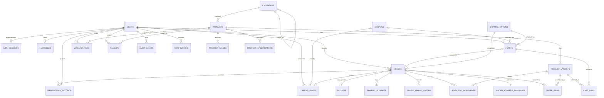

# NexaCart — Database Schema and ERD

| Field | Value |
|---|---|
| Document | docs/planning/DATABASE_SCHEMA_AND_ERD.md |
| Version | 0.2 — updated draft for owner review |
| Status | **Draft under owner review; not implemented.** Updated for the owner's PostgreSQL 16, native UUID generation, named-constraint, nightly-cleanup and review-locking specifications. The public hosting provider remains deliberately deferred. |
| Date | 2026-10-20 |
| Primary baseline | docs/planning/PRD.md v0.7 |
| Architecture | docs/planning/TECHNICAL_ARCHITECTURE.md v0.3 draft; public hosting provider deferred |
| Not yet created | docs/planning/IMPLEMENTATION_PLAN_AND_BACKLOG.md |

## 1. Purpose and design rules

This document translates approved product requirements into a proposed physical PostgreSQL schema. It is a planning artifact, not an implemented migration. Every table, constraint and index is subject to review before SQLAlchemy models and Alembic migrations are written.

- PostgreSQL is the durable source of truth. Business-critical state must not exist only in process memory.
- Store monetary amounts as integer minor units (ZAR cents), never as binary floating point.
- Store times as TIMESTAMPTZ in UTC and exchange ISO-8601 timestamps through the API.
- Target database is PostgreSQL 16 (use the latest available minor release in the 16 major line). Every generated UUID primary key and generated `auth_sessions.jti` uses the native PostgreSQL `gen_random_uuid()` default. No extension is required for this function on PostgreSQL 16.
- Write schemas are strict. Clients cannot set role, ownership, stock, prices, discounts, totals, shipping fees or order/payment/refund status.
- Use deactivation rather than hard deletion for products, variants and categories referenced by orders (BR-061).
- Order line and delivery-address snapshots must not change after placement (BR-050, FR-015).
- Order history, inventory movements and audit events are append-only (BR-042, BR-052, BR-066, FR-076, FR-100).
- Every CHECK constraint and every partial index has an explicit, stable name listed in §5. Migrations must create those exact names; never rely on PostgreSQL-generated names.
- Use JSONB for flexible canonical variant options, replay response bodies and safe audit summaries—not for relational identity or fields needing database uniqueness.
- §3.8 defines the canonical API string-length contract. Where the PRD provides a bound, it is authoritative; where the PRD is silent, explicitly marked schema-design limits are proposed here and must be used identically by request schemas and database columns/constraints. The repository contains no implemented request schemas yet, so length parity must be verified by schema-boundary tests when code is built.
- Use Alembic migrations as the schema source of truth. Do not create the production schema implicitly during application startup.

## 2. Entity relationship diagram

This conceptual ERD shows the main persisted relationships. It is not intended to substitute for the detailed constraints below.

The cart lock is physically stored as nullable carts.locked_by_order_id → orders.id. The order does not need a foreign key back to a cart, avoiding a circular insert dependency. Reviews attach to products, not variants. Orders preserve their delivery-address values without a foreign key to the mutable address book. Payment and refund status are derived projections, not competing mutable copies of the source records.

## 3. Core table definitions

Types below are PostgreSQL-oriented. All tables also receive UUID primary keys unless a naturally unique primary key is specified, and timestamp columns as noted.

### 3.1 Identity and session security

#### users

One row per customer or administrator.

| Column | Type and rule |
|---|---|
| id | UUID primary key DEFAULT `gen_random_uuid()` |
| name | VARCHAR(100), required, trimmed and not blank |
| email | VARCHAR(254), required, trimmed/lowercase, unique case-insensitively |
| password_hash | TEXT, required adaptive hash; never returned or logged |
| phone | VARCHAR(16), nullable; validated to 7–15 digits with optional leading + |
| role | TEXT, CHECK in customer/admin; registration always creates customer |
| is_active | BOOLEAN, required, default true |
| created_at, updated_at | TIMESTAMPTZ, required |
| password_changed_at | TIMESTAMPTZ, nullable |

Constraint uq_users_email and role check implement BR-001–006. Public registration cannot set role; admin provisioning is seed/CLI only (FR-010, SEC-008).

#### auth_sessions

Durable JWT session state so logout and password-change revocation work across API replicas.

| Column | Type and rule |
|---|---|
| jti | UUID primary key DEFAULT `gen_random_uuid()` and JWT ID |
| user_id | UUID FK to users.id, required |
| issued_at, expires_at | TIMESTAMPTZ; expiry must be later than issue time |
| revoked_at | TIMESTAMPTZ, nullable |
| revocation_reason | TEXT, nullable, controlled safe reason |
| csrf_token_hash | TEXT, required; store a hash, never the raw CSRF token |
| created_at | TIMESTAMPTZ, required |

Index by user_id and expiry. An authenticated request validates signature, pinned algorithm, expiry, revocation/session state and the current database role. Cookie logout revokes the session and clears the cookie. Password change revokes all older sessions and forces login with the new password (SEC-003–005, CL-17). Raw JWTs and CSRF values must not be stored or logged.

#### login_throttle_state

| Column | Type and rule |
|---|---|
| email_key | VARCHAR(254) primary key; normalized identifier |
| consecutive_failures | INTEGER, non-negative |
| locked_until | TIMESTAMPTZ, nullable |
| updated_at | TIMESTAMPTZ, required |

Use atomic updates for the account-based BR-007 lockout. Five consecutive failed attempts lock the account for 15 minutes; a successful login clears the counter. Unknown-email and wrong-password responses remain indistinguishable (BR-004). Keep this state out of response bodies and logs.

### 3.2 Catalog and assets

#### categories

| Column | Type and rule |
|---|---|
| id | UUID primary key DEFAULT `gen_random_uuid()` |
| parent_id | UUID nullable FK to categories.id |
| slug | VARCHAR(120), unique, required |
| name | VARCHAR(100), required |
| description | VARCHAR(1000), nullable |
| is_active | BOOLEAN, required |
| is_small_goods | BOOLEAN, default false |
| sort_order | INTEGER, non-negative |
| created_at, updated_at | TIMESTAMPTZ, required |

A top-level category has no parent; prevent self-parenting. Enforce maximum depth of two levels in the service, because a basic row CHECK cannot validate arbitrary tree depth. Wearables and Audio is designated small-goods, with the designation inherited by its subcategories (BR-077). Prevent deactivation while active products or active subcategories remain (BR-061, FR-089).

#### products

| Column | Type and rule |
|---|---|
| id | UUID primary key DEFAULT `gen_random_uuid()` |
| category_id | UUID FK to categories.id, required |
| slug | VARCHAR(160), globally unique and immutable |
| base_sku | VARCHAR(80), unique required product code |
| name | VARCHAR(200), required |
| brand | VARCHAR(100), required |
| description | VARCHAR(5000), required, non-blank |
| is_active, is_featured, is_fictional | BOOLEAN; fictional defaults true |
| rating_average | NUMERIC(3,1), 0.0–5.0 cached aggregate |
| rating_count | INTEGER, non-negative cached aggregate |
| created_at, updated_at | TIMESTAMPTZ, required |

Index by active/category and newest ordering. Products referenced by orders are deactivated/reactivated, not hard-deleted. Rating values are denormalized read projections and must be recalculated transactionally from visible reviews (BR-060, FR-081–082); review rows remain the underlying evidence.

#### product_variants

| Column | Type and rule |
|---|---|
| id | UUID primary key DEFAULT `gen_random_uuid()` |
| product_id | UUID FK to products.id, required |
| sku | VARCHAR(80), globally unique |
| options | JSONB canonical option map; at most 10 entries, option keys 1–50 characters and string values 1–100 characters |
| options_key | VARCHAR(2000) canonical representation of normalized options |
| unit_price_minor | BIGINT, positive integer cents |
| stock_quantity | INTEGER, never negative |
| is_active | BOOLEAN, required |
| is_default | BOOLEAN, required, default false; true only for the sole no-options variant of a product |
| created_at, updated_at | TIMESTAMPTZ, required |

Required constraints: unique (product_id, options_key), unique SKU, positive price and non-negative stock. The same normalization routine must sort and normalize option names/values before producing options_key. Do not rely on arbitrary JSON text formatting for uniqueness. A product without options has exactly one empty-options default variant; a partial unique index enforces at most one such default and the service requires it at product creation. Product/variant SKU and identity fields are immutable (BR-010–013, NFR-006).

#### product_images

| Column | Type and rule |
|---|---|
| id | UUID primary key DEFAULT `gen_random_uuid()` |
| product_id | UUID FK to products.id |
| asset_key | VARCHAR(240), key to a managed local/original/licensed asset; no arbitrary external URL |
| alt_text | VARCHAR(250), required and non-blank |
| is_primary | BOOLEAN, required |
| sort_order | INTEGER, non-negative |
| created_at | TIMESTAMPTZ, required |

A partial unique index permits at most one primary image per product. The service enforces one primary and 1–8 images for a complete product. Use a managed placeholder if an intended asset is missing; no runtime third-party image requests (PRD §5.2, FR-029, FR-097).

#### product_specifications

| Column | Type and rule |
|---|---|
| id | UUID primary key DEFAULT `gen_random_uuid()` |
| product_id | UUID FK to products.id |
| name | VARCHAR(100), required |
| value | VARCHAR(500), required |
| sort_order | INTEGER, non-negative |

Unique (product_id, normalized name). Keeping key/value specifications separate avoids mixing display attributes with identity and pricing.

### 3.3 Addresses, cart and wishlist

#### addresses

| Column | Type and rule |
|---|---|
| id | UUID primary key DEFAULT `gen_random_uuid()` |
| customer_id | UUID FK to users.id |
| recipient_name | VARCHAR(100), required |
| phone | VARCHAR(16), required |
| line1 | VARCHAR(150), required |
| line2 | VARCHAR(150), nullable |
| city | VARCHAR(80), required |
| province | VARCHAR(80), required |
| postal_code | VARCHAR(4), required four-digit postal code for the configured South African delivery country |
| country_code | CHAR(2), single configured delivery country |
| is_default | BOOLEAN, required |
| created_at, updated_at | TIMESTAMPTZ, required |

Index by customer and creation time. A partial unique index allows at most one default address per customer. The address service guarantees exactly one default whenever the collection is non-empty, auto-selects the first address and promotes the most recently created remaining address when the default is deleted. The maximum of ten addresses is enforced in a transaction (BR-008–009). Order snapshots deliberately do not reference the address row.

#### carts

| Column | Type and rule |
|---|---|
| id | UUID primary key DEFAULT `gen_random_uuid()` |
| customer_id | UUID FK to users.id, unique; one cart per customer |
| applied_coupon_id | UUID nullable FK to coupons.id; selection only, no usage reservation |
| shipping_option_id | UUID FK to shipping_options.id, default Standard |
| locked_by_order_id | UUID nullable FK to orders.id; pending order that holds the lock |
| created_at, updated_at | TIMESTAMPTZ, required |

Carts survive logout/login; the cart does not reserve stock. Lock the cart row during mutation/placement. While an order is pending, mutation requests return CART_LOCKED. After payment approval, clear cart lines and selections and unlock; after unpaid cancellation/expiry, retain and revalidate lines/selections and unlock (BR-019, BR-071–072, FR-031, FR-112–113). Use a unique partial index on non-null locked_by_order_id.

#### cart_lines

| Column | Type and rule |
|---|---|
| id | UUID primary key DEFAULT `gen_random_uuid()` |
| cart_id | UUID FK to carts.id |
| variant_id | UUID FK to product_variants.id |
| quantity | INTEGER 1–10 |
| last_acknowledged_unit_price_minor | BIGINT, informational price-change reference only |
| created_at, updated_at | TIMESTAMPTZ, required |

Unique (cart_id, variant_id), and quantity CHECK. Limit each cart to 20 distinct lines. Validate current stock within the cart transaction. The stored acknowledged/reference price supports the informational price_changed flag; it is never authoritative for pricing. Checkout always recalculates using current server values and compares the submitted expected total (BR-018–022, FR-037).

#### wishlist_items

| Column | Type and rule |
|---|---|
| id | UUID primary key DEFAULT `gen_random_uuid()` |
| customer_id | UUID FK to users.id |
| product_id | UUID FK to products.id |
| created_at | TIMESTAMPTZ, required |

Unique (customer_id, product_id). New adds require an active product; existing wishlist entries can persist and show an unavailable flag after product deactivation/stock change. Moving to cart removes the wishlist row only if cart insertion succeeds, within one atomic operation (BR-023, FR-041–045).

### 3.4 Coupons and shipping

#### coupons

| Column | Type and rule |
|---|---|
| id | UUID primary key DEFAULT `gen_random_uuid()` |
| code | VARCHAR(20), uppercase normalized, unique |
| discount_type | TEXT, CHECK percentage/fixed |
| percentage_basis_points | INTEGER nullable; percentage without binary floating point |
| fixed_discount_minor | BIGINT nullable |
| maximum_discount_minor | BIGINT nullable |
| minimum_order_minor | BIGINT, non-negative pre-discount minimum |
| minimum_is_exclusive | BOOLEAN, selects > versus >= comparison |
| starts_at, expires_at | TIMESTAMPTZ; interval [starts_at, expires_at) |
| is_active | BOOLEAN, required |
| global_usage_limit | INTEGER nullable |
| per_customer_usage_limit | INTEGER nullable |
| eligibility_rule | TEXT, CHECK all_customers/returning_customer |
| created_at, updated_at | TIMESTAMPTZ, required |

Enforce consistency between discount_type and its value columns, non-negative values/caps, positive limits when present, unique code and starts_at < expires_at. Coupons are seeded and are not managed via public admin UI (NG-09). Seed values live in seed data rather than duplicated application constants.

**Owner-approved coupon validation order (GAP-11):** normalize/lookup → active and validity window → customer eligibility → minimum amount → usage limits → calculate discount/caps. The same shared validator is used when applying a coupon and revalidating at placement. The first failing check determines the one returned code. Applying a coupon does not reserve a use.

#### coupon_usages

| Column | Type and rule |
|---|---|
| id | UUID primary key DEFAULT `gen_random_uuid()` |
| coupon_id | UUID FK to coupons.id |
| customer_id | UUID FK to users.id |
| order_id | UUID FK to orders.id, unique |
| usage_state | TEXT, CHECK reserved/consumed/released |
| reserved_at | TIMESTAMPTZ, required |
| finalized_at | TIMESTAMPTZ, nullable |

Create during TX-1 when usage is counted. On unpaid cancellation/expiry, reserved becomes released. On successful payment, reserved becomes consumed. Paid-order cancellation does not release consumed usage (BR-035). Counts for global and per-customer limits include reserved and consumed records. Lock the relevant coupon/usage state before checking limits, so concurrent placement cannot overrun the final use. Only one coupon is allowed per order.

#### shipping_options

| Column | Type and rule |
|---|---|
| id | UUID primary key DEFAULT `gen_random_uuid()` |
| code | VARCHAR(30), unique, stable code such as standard or express |
| display_name | VARCHAR(80), required |
| base_fee_minor | BIGINT, non-negative |
| delivery_estimate | VARCHAR(100), static configured estimate |
| is_active | BOOLEAN, required |
| sort_order | INTEGER, non-negative |

Seed Standard at 6000 cents and Express at 12000 cents. The pricing service calculates the applied Standard fee according to BR-076; Express is always charged. Free Standard shipping applies only to an eligible first order with pre-coupon subtotal at least R250.00 and below R1,000.00. Coupon discounts never affect shipping eligibility. Store the actual applied fee and selected shipping option details in the order snapshot.

### 3.5 Orders, payment and refunds

#### orders

The order header is created as pending in TX-1. Payment is a separate TX-2 operation.

| Column | Type and rule |
|---|---|
| id | UUID primary key DEFAULT `gen_random_uuid()` |
| order_number | VARCHAR(18), unique generated `NC-YYYYMMDD-NNNNNN`; never authorization |
| customer_id | UUID FK to users.id |
| status | TEXT CHECK pending/confirmed/processing/shipped/delivered/cancelled |
| subtotal_minor, discount_minor, shipping_fee_minor, total_minor | BIGINT, non-negative cents |
| coupon_code_snapshot | VARCHAR(20), nullable |
| shipping_option_id | UUID FK to shipping_options.id; snapshot fields preserve history |
| shipping_option_code_snapshot | VARCHAR(30) |
| shipping_option_name_snapshot | VARCHAR(80) |
| reservation_deadline | TIMESTAMPTZ, fixed from placement and never extended by retries |
| placed_at | TIMESTAMPTZ, required |
| cancelled_at | TIMESTAMPTZ, nullable |
| created_at, updated_at | TIMESTAMPTZ, required |

Unique order number; index (customer_id, placed_at DESC) and (status, reservation_deadline). A partial unique index uq_one_pending_order_per_customer on customer_id WHERE status = pending enforces at most one pending order per customer (BR-071, NFR-006). Amount checks enforce total = subtotal − discount + shipping fee. TX-1 commits order header, items, address snapshot, stock movements, coupon usage, cart lock and idempotency record together.

**Derived status projections:** payment_status is derived from attempts: no attempts = unpaid; any approved attempt = paid; attempts exist but none approved = failed. refund_status is not_applicable if no refund exists, otherwise it comes from the refund row. Use a SQL view/query helper for these projections instead of storing a second competing mutable status.

#### order_items

| Column | Type and rule |
|---|---|
| id | UUID primary key DEFAULT `gen_random_uuid()` |
| order_id | UUID FK to orders.id |
| product_id | UUID FK to products.id; restrict delete |
| variant_id | UUID FK to product_variants.id; restrict delete |
| product_name_snapshot | VARCHAR(200), required |
| variant_description_snapshot | VARCHAR(1000), required |
| sku_snapshot | VARCHAR(80), required |
| image_asset_key_snapshot | VARCHAR(240), required local asset key |
| unit_price_minor | BIGINT, positive integer cents |
| quantity | INTEGER, positive |
| line_total_minor | BIGINT, equals unit_price_minor × quantity |
| created_at | TIMESTAMPTZ, required |

Unique (order_id, variant_id) because identical variant cart lines merge. Store snapshots to preserve order history after catalog changes. Do not update snapshot fields after placement (BR-050, BR-068).

#### order_address_snapshots

One immutable delivery address per order, without an FK to the editable addresses table.

| Column | Type and rule |
|---|---|
| order_id | UUID primary key and FK to orders.id |
| recipient_name | VARCHAR(100) |
| phone | VARCHAR(16) |
| line1, line2 | VARCHAR(150); line2 nullable |
| city, province | VARCHAR(80) |
| postal_code | VARCHAR(4) |
| country_code | CHAR(2) |
| created_at | TIMESTAMPTZ |

Insert exactly once during TX-1. Later edits/deletion of a saved address do not affect this snapshot (FR-015).

#### order_status_history

| Column | Type and rule |
|---|---|
| id | UUID primary key DEFAULT `gen_random_uuid()` |
| order_id | UUID FK to orders.id |
| from_status | TEXT nullable only for initial event |
| to_status | TEXT, valid order status |
| actor_type | TEXT CHECK customer/admin/system |
| actor_user_id | UUID nullable FK to users.id |
| reason | VARCHAR(200), nullable |
| request_id | VARCHAR(100), nullable |
| occurred_at | TIMESTAMPTZ, required |

Index by (order_id, occurred_at). Append the initial pending event and every permitted status transition in the same transaction as the order update. Admin cancellation requires a 1–200 character reason; customer cancellation requires none (CL-19). No normal operation updates or deletes history rows (BR-052, FR-076).

#### payment_attempts

Every committed simulated attempt is recorded; no card details exist.

| Column | Type and rule |
|---|---|
| id | UUID primary key DEFAULT `gen_random_uuid()` |
| order_id | UUID FK to orders.id |
| attempt_number | INTEGER, positive, sequential per order |
| outcome | TEXT CHECK approved/declined/timed_out/error |
| amount_minor | BIGINT, equals the order total |
| idempotency_key | VARCHAR(64), required |
| idempotency_record_id | UUID nullable FK to idempotency_records.id with `ON DELETE SET NULL`, unique when non-null; cleanup must not be blocked by a historical payment-attempt reference |
| occurred_at | TIMESTAMPTZ, required |

Constraints: unique (order_id, attempt_number), unique (order_id, idempotency_key), at most one approved attempt per order via a partial unique index. The service enforces attempt cap and amount equality. A payment request rejected because the order is cancelled/expired, already paid or over the attempt limit creates no attempt and no idempotency record (BR-046–049, BR-069). The timeout delay occurs before TX-2 and does not hold a database lock. When an idempotency record is purged after expiry, `ON DELETE SET NULL` clears its optional link from the retained payment-attempt row; the payment audit fields themselves remain.

#### refunds

| Column | Type and rule |
|---|---|
| id | UUID primary key DEFAULT `gen_random_uuid()` |
| order_id | UUID FK to orders.id, unique |
| amount_minor | BIGINT, equals amount paid/order total |
| status | TEXT CHECK refund_pending/refunded |
| created_at | TIMESTAMPTZ, required |
| completed_at | TIMESTAMPTZ, nullable |
| reason | VARCHAR(200), nullable |

Only an order with an approved payment may have one full simulated refund. Create the refund atomically with paid-order cancellation in R2; complete it later in an idempotent worker transaction. No refund row is created for unpaid cancellation. Do not connect a real payment processor (NG-01, BR-055–056, FR-073–074, FR-109).

### 3.6 Idempotency and inventory ledger

#### idempotency_records

Durable replay response storage for the 24-hour idempotency contract.

| Column | Type and rule |
|---|---|
| id | UUID primary key DEFAULT `gen_random_uuid()` |
| customer_id | UUID FK to users.id |
| scope | VARCHAR(100), place_order or pay_order:<order UUID> |
| key_value | VARCHAR(64), validate allowed 8–64 characters |
| request_fingerprint | CHAR(64), SHA-256 of canonical permitted payload |
| response_status | SMALLINT, original HTTP status |
| response_body | JSONB, original safe response body |
| order_id | UUID nullable FK to orders.id |
| created_at, expires_at | TIMESTAMPTZ; expires_at at least 24 hours after creation |

Unique (customer_id, scope, key_value); index expires_at for cleanup. Same key/same fingerprint within retention replays the stored status/body without side effects. Same key/different fingerprint returns 422 IDEMPOTENCY_KEY_REUSED. A rejected operation that commits no state change leaves no record. Never purge an unexpired record (BR-048, BR-070).

#### inventory_movements

Append-only stock ledger. For every variant, current stock must equal the sum of committed movement deltas, including the initial-stock movement (BR-042).

| Column | Type and rule |
|---|---|
| id | UUID primary key DEFAULT `gen_random_uuid()` |
| variant_id | UUID FK to product_variants.id |
| delta_quantity | INTEGER, non-zero signed change |
| reason_code | TEXT CHECK initial_stock/order_placed/order_cancelled/reservation_expired/admin_adjustment |
| order_id | UUID nullable FK to orders.id for order-related movement |
| order_item_id | UUID nullable FK to order_items.id for per-line movement |
| reference_type | TEXT controlled type such as seed/order_item/admin_adjustment |
| reference_id | UUID nullable related record |
| operation_key | VARCHAR(160), stable unique deduplication key |
| actor_user_id | UUID nullable FK to users.id; null for system/seed |
| reason_text | VARCHAR(200), required 1–200 chars for admin adjustment |
| occurred_at | TIMESTAMPTZ, required |

Unique operation_key; index (variant_id, occurred_at) and reference fields. Write stock balance changes and movements in the same transaction. Seed an initial_stock movement for every variant. Any correction is a new audited adjustment, never an edit to ledger history. The database prevents negative stock; a conditional update and row locking prevent overselling (BR-037–042).

#### audit_events

Append-only sensitive-action history required in R2 (BR-066).

| Column | Type and rule |
|---|---|
| id | UUID primary key DEFAULT `gen_random_uuid()` |
| actor_user_id | UUID nullable FK to users.id |
| actor_role | TEXT role snapshot |
| action | VARCHAR(100), controlled action |
| entity_type | VARCHAR(80) |
| entity_id | UUID nullable |
| before_summary, after_summary | JSONB nullable, safe minimal summaries |
| request_id | VARCHAR(100), required |
| occurred_at | TIMESTAMPTZ, required |

Indexes by timestamp, actor, action and entity. Never store passwords, hashes, JWTs, cookies, CSRF values or secret configuration in event summaries. Deny normal application updates/deletes.

### 3.7 Reviews and optional notifications

#### reviews

| Column | Type and rule |
|---|---|
| id | UUID primary key DEFAULT `gen_random_uuid()` |
| customer_id | UUID FK to users.id |
| product_id | UUID FK to products.id |
| verified_order_id | UUID FK to orders.id, evidence reference |
| rating | SMALLINT CHECK 1–5 |
| comment | VARCHAR(1000), nullable |
| is_hidden | BOOLEAN default false |
| hidden_by_user_id | UUID nullable FK to users.id |
| hidden_at | TIMESTAMPTZ nullable |
| created_at | TIMESTAMPTZ, required |

Unique (customer_id, product_id); index by product and newest-first date. At submission, the service verifies the order belongs to the customer, is delivered, and contains any variant of the reviewed product. A simple FK cannot prove this cross-table eligibility rule. Customer review edit/delete is not in MVP. Admin hiding updates visibility, recalculates visible rating average/count, and is audit logged (BR-058–060, FR-077–082).

#### notifications (R3 only)

| Column | Type and rule |
|---|---|
| id | UUID primary key DEFAULT `gen_random_uuid()` |
| customer_id | UUID FK to users.id |
| notification_type | TEXT approved event type |
| payload | JSONB minimal display data; no secrets |
| created_at | TIMESTAMPTZ |
| read_at | TIMESTAMPTZ nullable |

Index (customer_id, created_at DESC). R3 notifications are optional and require separate release approval (FR-101–102, BR-067); do not implement them as part of R1.

### 3.8 Request and persisted-field string-length contract

The API request models and database columns/constraints must share one length contract. Enforce the same minimum/maximum values in FastAPI validation and in the matching bounded column or named CHECK constraint; add a boundary test for each maximum. Where the PRD specifies a bound, that bound is fixed. **The PRD leaves several catalogue-field maximums unstated**, so the values marked *schema proposal* below are the proposed canonical limits for owner review. The project currently has no implemented request schemas; they will be written against this contract after approval.

| Request/input field | Canonical limit | Database representation | Basis |
|---|---|---|---|
| Account name | 1–100 characters after trimming | users.name VARCHAR(100) plus `ck_users_name_nonblank` | BR-003 |
| Email | 1–254 characters; trimmed and lowercase for storage | users.email VARCHAR(254) plus `ck_users_email_normalized` | BR-002 |
| Password | 8–128 characters; never store raw value | password_hash TEXT stores adaptive hash only | BR-001 |
| Phone | 7–15 digits, optional leading +; maximum physical length 16 | VARCHAR(16) | BR-003, BR-008 |
| Address recipient | 1–100 characters | VARCHAR(100) | BR-008 |
| Address line 1 / line 2 | 1–150 / optional 0–150 | VARCHAR(150) | BR-008 |
| City / province | 1–80 characters each | VARCHAR(80) | BR-008 |
| Postal code | Exactly 4 digits | VARCHAR(4) with `ck_addresses_postal_code_format` | BR-008 |
| Country code | Exactly 2 uppercase letters; configured country only | CHAR(2) | DEC-17 |
| Search query | 2–100 characters after trim and whitespace normalization | Query only; no persisted field | BR-014 |
| Coupon code | 3–20 characters from A–Z, 0–9, underscore, hyphen; normalized uppercase | coupons.code VARCHAR(20) with `ck_coupons_code_format` | BR-031 |
| Idempotency key | 8–64 permitted characters | VARCHAR(64) with named key-format checks | BR-070 |
| Review comment | Optional, up to 1,000 characters | reviews.comment VARCHAR(1000) | BR-059 |
| Admin cancellation / inventory-adjustment reason | 1–200 characters | VARCHAR(200); service validates only for the relevant admin action | BR-062, CL-09, CL-11 |
| Category name | 1–100 characters (*schema proposal; maximum not numeric in PRD*) | VARCHAR(100) | Proposed shared request/DB limit |
| Category slug | 1–120 characters (*schema proposal*) | VARCHAR(120) and unique | Proposed shared request/DB limit |
| Category description | Optional, up to 1,000 characters (*schema proposal*) | VARCHAR(1000) | Proposed shared request/DB limit |
| Product name | 1–200 characters (*schema proposal; PRD requires nonblank and tests the over-limit boundary but does not state number*) | VARCHAR(200) | FR-084–085, AC-103 |
| Product brand | 1–100 characters (*schema proposal*) | VARCHAR(100) | Proposed shared request/DB limit |
| Product slug | 1–160 characters (*schema proposal*) | VARCHAR(160) and unique | Proposed shared request/DB limit |
| Product/base and variant SKU | 1–80 characters (*schema proposal*) | VARCHAR(80) and unique per approved scope | BR-013; exact maximum proposed |
| Product description | 1–5,000 characters (*schema proposal*) | VARCHAR(5000) | Proposed shared request/DB limit |
| Variant option key/value | Key 1–50; string value 1–100; at most 10 entries (*schema proposal*) | JSONB with the same validator limits; canonical options key VARCHAR(2000) | DEC-06 and variant option requirements |
| Image asset key | 1–240 characters (*schema proposal; managed local asset only*) | VARCHAR(240) | NG-10, FR-097 |
| Image alt text | 1–250 characters, nonblank | VARCHAR(250) | FR-029 |
| Product specification name/value | Name 1–100; value 1–500 characters (*schema proposal*) | VARCHAR(100) / VARCHAR(500) | Product specification model |
| Shipping option code/name/estimate | Code 1–30; name 1–80; estimate 1–100 (*schema proposal*) | Matching VARCHAR columns | FR-049 |
| Payment or order status values | Enumerated values only; not arbitrary free text | TEXT plus named CHECK constraint | BR-043–044, BR-056 |
| Order status-history reason | Optional 0–200; admin cancellation request separately requires 1–200 | VARCHAR(200) | BR-052, BR-062, CL-09 |
| Request/correlation ID | Up to 100 characters (*technical proposal*) | VARCHAR(100) where persisted | NFR-015–016 |
| Inventory operation key | Up to 160 characters (*technical internal cap*) | VARCHAR(160) | Idempotent ledger write |

This table is the source for the future request model limits. Do not infer that these limits have already been validated in code: implementation and CI contract checks are still pending.

## 4. Derived read models

Use views/query helpers instead of duplicating mutable state unless measurement proves a cache necessary.

| Projection | Source / rule |
|---|---|
| Order payment status | No attempts = unpaid; any approved attempt = paid; attempts with no approval = failed |
| Order refund status | No refund = not_applicable; otherwise refund row status |
| Product availability | Active product/category and active variants; per-variant state derived from stock |
| Product from-price | Lowest active variant price |
| Rating aggregate | Visible review average rounded half-up to one decimal and visible count |
| Cart line flags | Current variant/product state, available stock and acknowledged price reference; checkout still revalidates |
| Cart minimum-order flag | Pre-coupon subtotal and unit quantities from small-goods categories |
| Coupon usage limits | Count reserved and consumed coupon_usages by coupon and customer |
| WELCOME10 eligibility | Customer has at least one order reaching shipped/delivered; cancelled/unshipped orders do not qualify |
| Inventory reconciliation | Stored stock_quantity compared with sum of movement deltas |

## 5. Explicitly named constraints and indexes

**Migration naming requirement:** the inventory below is the canonical name registry. Every CHECK constraint and every partial index must be created with its explicit name in the Alembic migration (or equivalent SQL). No unnamed CHECK or partial index is permitted. Other primary-key, foreign-key and unique constraints must also use explicit stable names, using the `pk_<table>`, `fk_<table>_<column>_<target>` and `uq_<table>_<rule>` conventions. Name supporting indexes explicitly with `ix_<table>_<purpose>`.

### 5.1 CHECK constraints

| Explicit constraint name | Definition / invariant | Source |
|---|---|---|
| `ck_users_name_nonblank` | `btrim(name) <> ''` | BR-003 |
| `ck_users_email_normalized` | Stored email is trimmed and lowercase | BR-002 |
| `ck_users_role` | Role is customer or admin | BR-006 |
| `ck_users_phone_format` | Null or `^\\+?[0-9]{7,15}### 5.1 CHECK constraints

| Explicit constraint name | Definition / invariant | Source |
|---|---|---|
| `ck_users_name_nonblank` | `btrim(name) <> ''` | BR-003 |
| `ck_users_email_normalized` | Stored email is trimmed and lowercase | BR-002 |
| `ck_users_role` | Role is customer or admin | BR-006 |
 | BR-003 |
| `ck_auth_sessions_expiry_after_issue` | `expires_at > issued_at` | BR-005 |
| `ck_login_throttle_failures_nonnegative` | `consecutive_failures >= 0` | BR-007 |
| `ck_categories_name_nonblank` | Trimmed name is not blank | Category write schema |
| `ck_categories_sort_order_nonnegative` | `sort_order >= 0` | Category ordering |
| `ck_categories_not_own_parent` | Parent is null or `parent_id <> id` | Category hierarchy |
| `ck_products_name_nonblank` | Trimmed name is not blank | FR-084–085 |
| `ck_products_brand_nonblank` | Trimmed brand is not blank | Product write schema |
| `ck_products_rating_average_range` | `rating_average BETWEEN 0 AND 5` | BR-060 |
| `ck_products_rating_count_nonnegative` | `rating_count >= 0` | BR-060 |
| `ck_product_variants_price_positive` | `unit_price_minor > 0` | BR-010 |
| `ck_product_variants_stock_nonnegative` | `stock_quantity >= 0` | BR-037 |
| `ck_product_variants_options_object` | `jsonb_typeof(options) = 'object'` | Variant write schema |
| `ck_product_variants_options_key_nonblank` | Canonical options key is not blank | Variant identity |
| `ck_product_variants_default_has_no_options` | `NOT is_default OR options_key = '{}'` | DEC-06 |
| `ck_product_images_alt_text_nonblank` | Trimmed alt text is not blank | FR-029, FR-097 |
| `ck_product_images_sort_order_nonnegative` | `sort_order >= 0` | Image ordering |
| `ck_product_specifications_name_nonblank` | Trimmed specification name is not blank | Product write schema |
| `ck_product_specifications_value_nonblank` | Trimmed specification value is not blank | Product write schema |
| `ck_product_specifications_sort_order_nonnegative` | `sort_order >= 0` | Specification ordering |
| `ck_addresses_recipient_nonblank` | Trimmed recipient name is not blank | BR-008 |
| `ck_addresses_phone_format` | `^\\+?[0-9]{7,15}### 5.1 CHECK constraints

| Explicit constraint name | Definition / invariant | Source |
|---|---|---|
| `ck_users_name_nonblank` | `btrim(name) <> ''` | BR-003 |
| `ck_users_email_normalized` | Stored email is trimmed and lowercase | BR-002 |
| `ck_users_role` | Role is customer or admin | BR-006 |
| `ck_users_phone_format` | Null or `^\\+?[0-9]{7,15}### 5.1 CHECK constraints

| Explicit constraint name | Definition / invariant | Source |
|---|---|---|
| `ck_users_name_nonblank` | `btrim(name) <> ''` | BR-003 |
| `ck_users_email_normalized` | Stored email is trimmed and lowercase | BR-002 |
| `ck_users_role` | Role is customer or admin | BR-006 |
 | BR-003 |
| `ck_auth_sessions_expiry_after_issue` | `expires_at > issued_at` | BR-005 |
| `ck_login_throttle_failures_nonnegative` | `consecutive_failures >= 0` | BR-007 |
| `ck_categories_name_nonblank` | Trimmed name is not blank | Category write schema |
| `ck_categories_sort_order_nonnegative` | `sort_order >= 0` | Category ordering |
| `ck_categories_not_own_parent` | Parent is null or `parent_id <> id` | Category hierarchy |
| `ck_products_name_nonblank` | Trimmed name is not blank | FR-084–085 |
| `ck_products_brand_nonblank` | Trimmed brand is not blank | Product write schema |
| `ck_products_rating_average_range` | `rating_average BETWEEN 0 AND 5` | BR-060 |
| `ck_products_rating_count_nonnegative` | `rating_count >= 0` | BR-060 |
| `ck_product_variants_price_positive` | `unit_price_minor > 0` | BR-010 |
| `ck_product_variants_stock_nonnegative` | `stock_quantity >= 0` | BR-037 |
| `ck_product_variants_options_object` | `jsonb_typeof(options) = 'object'` | Variant write schema |
| `ck_product_variants_options_key_nonblank` | Canonical options key is not blank | Variant identity |
| `ck_product_variants_default_has_no_options` | `NOT is_default OR options_key = '{}'` | DEC-06 |
| `ck_product_images_alt_text_nonblank` | Trimmed alt text is not blank | FR-029, FR-097 |
| `ck_product_images_sort_order_nonnegative` | `sort_order >= 0` | Image ordering |
| `ck_product_specifications_name_nonblank` | Trimmed specification name is not blank | Product write schema |
| `ck_product_specifications_value_nonblank` | Trimmed specification value is not blank | Product write schema |
| `ck_product_specifications_sort_order_nonnegative` | `sort_order >= 0` | Specification ordering |
| `ck_addresses_recipient_nonblank` | Trimmed recipient name is not blank | BR-008 |
 | BR-008 |
| `ck_addresses_line1_nonblank` | Trimmed line1 is not blank | BR-008 |
| `ck_addresses_city_nonblank` | Trimmed city is not blank | BR-008 |
| `ck_addresses_province_nonblank` | Trimmed province is not blank | BR-008 |
| `ck_addresses_postal_code_format` | Four numeric digits | BR-008 |
| `ck_addresses_country_code_format` | Two uppercase letters equal to configured delivery country | DEC-17 |
| `ck_cart_lines_quantity_range` | Quantity between 1 and 10 inclusive | BR-018 |
| `ck_cart_lines_acknowledged_price_nonnegative` | Null or non-negative integer cents | BR-022 |
| `ck_coupons_code_format` | Uppercase code matches `^[A-Z0-9_-]{3,20}$` | BR-031 |
| `ck_coupons_discount_type` | Percentage or fixed | FR-051 |
| `ck_coupons_percentage_range` | Null or basis points between 1 and 10000 | BR-026 |
| `ck_coupons_fixed_discount_positive` | Null or positive integer cents | BR-027 |
| `ck_coupons_maximum_discount_nonnegative` | Null or non-negative integer cents | BR-026 |
| `ck_coupons_minimum_order_nonnegative` | `minimum_order_minor >= 0` | BR-033 |
| `ck_coupons_discount_value_matches_type` | Percentage has percentage value and fixed coupon has fixed amount; irrelevant value column is null | FR-051 |
| `ck_coupons_validity_window` | `starts_at < expires_at` | BR-032 |
| `ck_coupons_global_usage_limit_positive` | Null or positive | BR-034 |
| `ck_coupons_per_customer_usage_limit_positive` | Null or positive | BR-034 |
| `ck_coupons_eligibility_rule` | All customers or returning customer | BR-075 |
| `ck_coupon_usages_state` | Reserved, consumed or released | BR-035 |
| `ck_shipping_options_fee_nonnegative` | `base_fee_minor >= 0` | BR-028 |
| `ck_shipping_options_sort_order_nonnegative` | `sort_order >= 0` | Shipping ordering |
| `ck_orders_status` | One of pending/confirmed/processing/shipped/delivered/cancelled | BR-043 |
| `ck_orders_money_nonnegative` | Subtotal, discount, fee and total are non-negative | BR-029 |
| `ck_orders_discount_not_above_subtotal` | `discount_minor <= subtotal_minor` | BR-026–029 |
| `ck_orders_total_arithmetic` | `total_minor = subtotal_minor - discount_minor + shipping_fee_minor` | BR-029 |
| `ck_orders_reservation_after_placement` | `reservation_deadline > placed_at` | BR-041 |
| `ck_orders_number_format` | `order_number ~ '^NC-[0-9]{8}-[0-9]{6}
| `ck_order_items_unit_price_positive` | `unit_price_minor > 0` | BR-010, BR-050 |
| `ck_order_items_quantity_positive` | `quantity > 0` | BR-018 |
| `ck_order_items_line_total` | `line_total_minor = unit_price_minor * quantity` | BR-029 |
| `ck_order_items_product_name_nonblank` | Snapshot name is not blank | BR-050 |
| `ck_order_address_snapshots_postal_code_format` | Four numeric digits | BR-008, BR-050 |
| `ck_order_status_history_to_status` | `to_status` is a legal order status | BR-043, BR-052 |
| `ck_order_status_history_from_status` | Null or a legal order status | BR-043, BR-052 |
| `ck_order_status_history_actor_type` | Customer/admin/system | BR-052 |
| `ck_payment_attempts_attempt_number_positive` | `attempt_number > 0` | FR-062, FR-067 |
| `ck_payment_attempts_outcome` | Approved/declined/timed_out/error | BR-044, BR-047 |
| `ck_payment_attempts_amount_positive` | `amount_minor > 0` | BR-046 |
| `ck_payment_attempts_idempotency_key_format` | 8–64 characters from the BR-070 alphabet | BR-070 |
| `ck_refunds_status` | Refund pending or refunded | BR-056 |
| `ck_refunds_amount_positive` | `amount_minor > 0` | BR-056 |
| `ck_refunds_completion_consistency` | Refunded iff completed_at is set; pending iff null | BR-056 |
| `ck_idempotency_records_scope_nonblank` | Trimmed scope is not blank | BR-070 |
| `ck_idempotency_records_key_format` | 8–64 permitted characters | BR-070 |
| `ck_idempotency_records_fingerprint_format` | Exactly 64 lowercase hexadecimal characters | BR-070 |
| `ck_idempotency_records_response_status` | HTTP status between 100 and 599 | API contract |
| `ck_idempotency_records_retention` | `expires_at >= created_at + interval '24 hours'` | BR-048, BR-070 |
| `ck_inventory_movements_delta_nonzero` | `delta_quantity <> 0` | BR-042 |
| `ck_inventory_movements_reason_code` | Only the five approved inventory movement reasons | BR-042 |
| `ck_inventory_movements_operation_key_nonblank` | Operation key is not blank | BR-038–042 |
| `ck_inventory_movements_admin_reason` | Admin adjustment requires a trimmed reason of 1–200 chars; system movements may use null | BR-062, CL-11 |
| `ck_audit_events_actor_role` | Customer/admin/system role snapshot | BR-066 |
| `ck_reviews_rating_range` | Rating between 1 and 5 | BR-059 |
| `ck_reviews_comment_length` | Null or length at most 1000 | BR-059 |
| `ck_reviews_hidden_metadata_consistency` | Visible reviews have null hide metadata; hidden reviews have both hidden user and timestamp | FR-082 |
| `ck_notifications_type` | Only approved R3 notification event types | BR-067 |

Checks that depend on another row, such as review eligibility, legal state transitions, max image count, max address count and max cart lines, remain service/transaction invariants; PostgreSQL CHECK constraints cannot safely enforce those cross-row predicates.

`; 18 characters | BR-051 |
| `ck_order_items_unit_price_positive` | `unit_price_minor > 0` | BR-010, BR-050 |
| `ck_order_items_quantity_positive` | `quantity > 0` | BR-018 |
| `ck_order_items_line_total` | `line_total_minor = unit_price_minor * quantity` | BR-029 |
| `ck_order_items_product_name_nonblank` | Snapshot name is not blank | BR-050 |
| `ck_order_address_snapshots_postal_code_format` | Four numeric digits | BR-008, BR-050 |
| `ck_order_status_history_to_status` | `to_status` is a legal order status | BR-043, BR-052 |
| `ck_order_status_history_from_status` | Null or a legal order status | BR-043, BR-052 |
| `ck_order_status_history_actor_type` | Customer/admin/system | BR-052 |
| `ck_payment_attempts_attempt_number_positive` | `attempt_number > 0` | FR-062, FR-067 |
| `ck_payment_attempts_outcome` | Approved/declined/timed_out/error | BR-044, BR-047 |
| `ck_payment_attempts_amount_positive` | `amount_minor > 0` | BR-046 |
| `ck_payment_attempts_idempotency_key_format` | 8–64 characters from the BR-070 alphabet | BR-070 |
| `ck_refunds_status` | Refund pending or refunded | BR-056 |
| `ck_refunds_amount_positive` | `amount_minor > 0` | BR-056 |
| `ck_refunds_completion_consistency` | Refunded iff completed_at is set; pending iff null | BR-056 |
| `ck_idempotency_records_scope_nonblank` | Trimmed scope is not blank | BR-070 |
| `ck_idempotency_records_key_format` | 8–64 permitted characters | BR-070 |
| `ck_idempotency_records_fingerprint_format` | Exactly 64 lowercase hexadecimal characters | BR-070 |
| `ck_idempotency_records_response_status` | HTTP status between 100 and 599 | API contract |
| `ck_idempotency_records_retention` | `expires_at >= created_at + interval '24 hours'` | BR-048, BR-070 |
| `ck_inventory_movements_delta_nonzero` | `delta_quantity <> 0` | BR-042 |
| `ck_inventory_movements_reason_code` | Only the five approved inventory movement reasons | BR-042 |
| `ck_inventory_movements_operation_key_nonblank` | Operation key is not blank | BR-038–042 |
| `ck_inventory_movements_admin_reason` | Admin adjustment requires a trimmed reason of 1–200 chars; system movements may use null | BR-062, CL-11 |
| `ck_audit_events_actor_role` | Customer/admin/system role snapshot | BR-066 |
| `ck_reviews_rating_range` | Rating between 1 and 5 | BR-059 |
| `ck_reviews_comment_length` | Null or length at most 1000 | BR-059 |
| `ck_reviews_hidden_metadata_consistency` | Visible reviews have null hide metadata; hidden reviews have both hidden user and timestamp | FR-082 |
| `ck_notifications_type` | Only approved R3 notification event types | BR-067 |

Checks that depend on another row, such as review eligibility, legal state transitions, max image count, max address count and max cart lines, remain service/transaction invariants; PostgreSQL CHECK constraints cannot safely enforce those cross-row predicates.

### 5.2 Partial indexes

Every partial index is explicitly named in the Alembic migration with its predicate; the predicate is part of the contract.

| Explicit index name | Definition | Purpose |
|---|---|---|
| `uq_product_images_primary` | Unique on `(product_id)` WHERE `is_primary IS TRUE` | At most one primary image per product |
| `uq_product_variants_one_default_per_product` | Unique on `(product_id)` WHERE `is_default IS TRUE` | At most one no-options default variant |
| `uq_addresses_one_default_per_customer` | Unique on `(customer_id)` WHERE `is_default IS TRUE` | At most one default address per customer |
| `uq_carts_locked_by_order` | Unique on `(locked_by_order_id)` WHERE `locked_by_order_id IS NOT NULL` | One cart is locked to at most one pending order |
| `uq_one_pending_order_per_customer` | Unique on `(customer_id)` WHERE `status = 'pending'` | Enforce BR-071 even under concurrent placement |
| `uq_one_approved_payment_per_order` | Unique on `(order_id)` WHERE `outcome = 'approved'` | At most one approved payment attempt per order |

### 5.3 Named uniqueness, foreign keys and supporting indexes

All PK, FK and full unique constraints are explicitly named in migrations as well. At minimum, create these stable names and indexes:

| Name | Definition |
|---|---|
| `pk_<table>` | Named primary key for each generated-ID table; for `order_address_snapshots`, the PK is `order_id` |
| `uq_users_email` | Unique normalized stored email |
| `uq_categories_slug` | Unique category slug |
| `uq_products_slug`, `uq_products_base_sku` | Unique catalog identity |
| `uq_product_variants_sku` | Unique variant SKU |
| `uq_variant_product_options` | Unique `(product_id, options_key)` |
| `uq_product_specifications_product_name` | Unique index on `(product_id, lower(btrim(name)))` |
| `uq_cart_customer` | One cart per customer |
| `uq_cart_line_variant` | Unique `(cart_id, variant_id)` |
| `uq_wishlist_customer_product` | Unique `(customer_id, product_id)` |
| `uq_coupon_code` | Unique normalized coupon code |
| `uq_coupon_usage_order` | One coupon usage row per order |
| `uq_order_number` | Unique human-readable order number |
| `uq_order_variant_line` | Unique `(order_id, variant_id)` |
| `uq_payment_attempt_number` | Unique `(order_id, attempt_number)` |
| `uq_payment_idempotency_key` | Unique `(order_id, idempotency_key)` |
| `uq_refund_order` | At most one refund row per order |
| `uq_idempotency_scope_key` | Unique `(customer_id, scope, key_value)` |
| `uq_inventory_operation_key` | Unique inventory-operation idempotency key |
| `uq_review_customer_product` | Unique `(customer_id, product_id)` |
| `fk_<table>_<column>_<target>` | Explicit name for every foreign key; add cyclic/cart-order or payment-idempotency references in a later migration step if required by creation order |
| `ix_auth_sessions_expires_at` | Index for expiry lookup and nightly cleanup |
| `ix_idempotency_records_expires_at` | Index for expiry lookup and nightly cleanup |
| `ix_orders_status_deadline` | Order expiry scan by status and deadline |
| `ix_order_status_history_order_time` | Order history retrieval in timestamp order |
| `ix_inventory_movements_variant_time` | Ledger reconciliation and variant movement history |
| `ix_reviews_product_created` | Visible product review pagination newest-first |

For case-insensitive matching, normalize email and coupon code on write and enforce the named CHECK constraints for normalized storage. If functional uniqueness is chosen instead of normalized storage, its unique expression index must also be explicitly named.

## 6. Transaction mapping

### TX-1 — order placement

Under the customer's cart lock, execute the exact state-check sequence in BR-074. If valid, create orders, order_items, order_address_snapshots, inventory_movements, coupon_usages when needed, cart lock, initial order_status_history and idempotency_records, while decrementing each variant's stock conditionally. Commit all effects together. A failure leaves no order, movement, usage, lock or idempotency row. Placement does not create a payment attempt.

Lock variants in deterministic ID order or use conditional updates that require sufficient stock. Never read stock, release the lock and then write an unconditional decrement. Any losing concurrent purchase receives INSUFFICIENT_STOCK and creates no partial state.

### TX-2 — payment

For a timeout outcome, wait before opening the transaction. Then lock/re-read the order and apply the BR-069 precedence. A non-payable/expired order receives ORDER_NOT_PAYABLE and creates no attempt. Within TX-2, write the idempotency record and payment_attempt; for approval also confirm the order, append status history, clear cart lines/selections and unlock it. Declined/timed_out/error attempts commit, but the pending order keeps its reservation and cart lock.

### Cancellation and reservation expiry

Serialize payment, cancellation and expiry using the order-level lock. For unpaid cancellation/expiry, change order status, append history, restore stock once, write matching inventory movements, release reserved coupon usage, and unlock the cart in one transaction. For paid cancellation in R2, restore stock and create one full refund; do not release consumed coupon usage. Repeated worker execution must be safe and idempotent (BR-053–056, BR-069–074).

### Inventory adjustment

Validate reason, lock the variant and conditionally apply the balance change. Reject a negative result. Write variant balance, movement and audit event in one transaction.

### Review creation/hide

Validate the delivered-order evidence and duplicate rule. Before inserting a review or changing a review's visibility, lock its parent `products` row with an explicit `SELECT ... FOR UPDATE` on the product ID. Hold that row lock while writing the review/hide state, querying the visible reviews to recompute the rounded half-up average and visible count, and updating `products.rating_average` / `products.rating_count`. Commit the review change, aggregate update and any required audit event in one transaction. Every review-create and review-hide path must acquire the same product-row lock before modifying review state; otherwise two concurrent transactions could each calculate an aggregate that omits the other's change. The product row acts as the per-product serialization point; no process-local lock is allowed.

## 7. Retention and deletion policy

| Data | Policy |
|---|---|
| Users | No public account-deletion flow in MVP; restrict deletion while referenced |
| Addresses | Customers may delete; order snapshots remain |
| Products/categories/variants | Deactivate instead of deleting if referenced by order history |
| Orders/items/address snapshots | Retain durable business history; no delete endpoint |
| Payment attempts/refunds | Change only through approved state transitions; never delete to mask failure |
| Coupon usage | Keep released rows for audit and correct usage semantics |
| Inventory movements, order history, audit events | Append-only |
| Idempotency records | A nightly cleanup job (default 02:00 UTC, configurable via `MAINTENANCE_CLEANUP_UTC`) deletes only rows with `expires_at <= now()`. Records must survive at least 24 hours; no unexpired key may be purged. Historical payment attempts do not prevent purge because their optional FK uses `ON DELETE SET NULL`. |
| Auth sessions | The same nightly job (default 02:00 UTC) deletes only sessions with `expires_at <= now()`; retain revocation state until the token has expired so a still-live revoked JWT remains rejected. Revocation never depends on process memory |
| Notifications | Customer-owned, R3 only |

## 8. Seed and reset requirements

The idempotent seed/reset implementation (FR-104, TR-003, TR-016) must satisfy PRD §5.4:

- Five top-level categories; at least two subcategories each; at least twelve products per top-level category (minimum sixty total); at least three products in each price tier per category.
- At least 50% of products have multiple variants. Include fixed fixtures for zero stock, one remaining unit, stock 5 and 6, inactive product, partially available variants, single default variant, no reviews and multiple known reviews.
- Include coupon/shipping/minimum order boundaries: R999.99, R1,000.00, R500.00, R250.00, R249.99, R800.00 and R800.01, plus qualifying small-goods cases.
- Include seed coupons and customer/order-state fixtures for first-order shipping and WELCOME10 eligibility.
- Write an initial_stock inventory movement for each seeded variant.
- Seed user accounts and passwords only in local/test configuration. Never publish known test passwords or put them in the public deployment.
- Use only synthetic catalogue data and managed original/licensed local assets.

Running seed twice must not duplicate inventory movements, coupon usage, orders, reviews or audit records. A test reset may rebuild the isolated test database; never expose reset of shared public data.

## 9. Migration and database verification

### Migration rules

1. All schema changes are versioned in Alembic.
2. Test migrations from an empty database and from the previous schema version on PostgreSQL 16.
3. Use explicit migration steps for partial indexes, constraints and data backfills.
4. Create every CHECK constraint with its exact name from §5.1 using `op.create_check_constraint(name=..., table_name=..., condition=...)`; create every partial index with its exact name and `postgresql_where=...`. Do not rely on database-generated names or unnamed inline CHECKs.
5. Use explicit names for primary keys, foreign keys, unique constraints and supporting indexes as described in §5.3.
6. Run migrations as a controlled release step; do not let each web/worker instance race at startup.
7. Document rollback limits and recovery steps rather than assuming every migration can safely downgrade.
8. Keep test seed passwords and environment secrets out of migration files.

### SQL assertions required by the backlog

- Unique normalized email and SKUs; valid role/status checks and foreign keys.
- Stock never negative and stock balance equals ledger delta sum.
- At most one pending order per customer, including concurrent attempts.
- TX-1 rollback leaves no order, item, snapshot, movement, coupon usage, cart lock or idempotency state.
- TX-2 failure leaves correct state; at most one approved payment and one refund per order.
- Correct coupon reserved/consumed/released counts under cancellation/expiry and concurrency.
- Same-key replay has no duplicate effects; same key with different payload conflicts.
- Address and catalogue edits do not alter order snapshots.
- Review uniqueness, eligibility evidence, and aggregate equality with visible reviews.
- Order status history, inventory movement ledger and audit events are append-only.
- Fresh install, migration upgrade and repeatable seed all pass.
- Test-support routes/controls are unavailable in production configuration.

## 10. Remaining schema review items

These are explicit approval or implementation checkpoints:

1. **String-length authority:** the PRD precisely defines bounds for core identity, address, coupon, idempotency and review fields but leaves several admin catalogue-field maxima unstated. §3.8 proposes canonical bounds so future Pydantic request schemas and database fields agree. The repository has no implemented request schemas yet, so parity must be verified with schema-boundary tests when code is built.
2. **Owner review of catalogue caps:** confirm the values marked *schema proposal* in §3.8. PRD-defined limits are fixed and are not awaiting approval.
3. **Architecture/schema approval:** both documents remain drafts until reviewed. Public hosting provider choice is deferred and does not block the relational model.

PostgreSQL 16, native `gen_random_uuid()`, explicit named CHECK constraints and partial indexes, nightly expiry cleanup, and the `SELECT ... FOR UPDATE` review-aggregate protocol are owner-specified and included. No migration file or application code has been created yet.

## Appendix A — Traceability

| Tables / constraints | Primary requirements |
|---|---|
| users, auth_sessions, login_throttle_state | FR-001–010; BR-001–007; SEC-002–005, SEC-014 |
| addresses, order_address_snapshots | FR-011–015; BR-008–009, BR-050 |
| categories, products, product_variants, product_images, product_specifications | FR-016–030, FR-084–089, FR-097; BR-010–017, BR-061 |
| carts, cart_lines | FR-031–040, FR-052–056, FR-111–116; BR-018–022, BR-068–074 |
| wishlist_items | FR-041–045; BR-023, BR-064 |
| coupons, coupon_usages, shipping_options | FR-046–051; BR-025–036, BR-075–077 |
| orders, order_items, order_status_history | FR-052–076, FR-109–115; BR-038–056, BR-068–074 |
| payment_attempts, idempotency_records | FR-056–067, FR-110, FR-114–115; BR-046–049, BR-068–070 |
| inventory_movements | FR-090, FR-092; BR-037–042, BR-068–073 |
| refunds | FR-073–074, FR-092, FR-109; BR-053–056 |
| reviews | FR-077–082; BR-058–060 |
| audit_events | FR-098–100; BR-066 |
| notifications | FR-101–102; BR-067; R3 only |
| Health/test support | FR-103–106; TR-004–010, TR-014–019; SEC-018 |

## Appendix B — Change log

| Version | Date | Change |
|---|---|---|
| 0.1 | 2026-10-20 | Initial proposed PostgreSQL schema and ERD based on approved PRD v0.7, User Stories v0.3 and Technical Architecture v0.2. No migration or application code implemented. |
| 0.2 | 2026-10-20 | Set PostgreSQL 16 and native `gen_random_uuid()`; established request/database string-length parity; enumerated explicit names for CHECK constraints and partial indexes; defined nightly expired-session/idempotency cleanup and the `SELECT ... FOR UPDATE` review-aggregate protocol. Updated idempotency foreign-key behaviour so retention cleanup cannot be blocked by historical payment attempts. |
