# NexaCart — User Stories and Flows

| Field | Value |
|---|---|
| Document | `docs/planning/USER_STORIES_AND_FLOWS.md` |
| Version | 0.2 — approved |
| Status | **Approved by the project owner on 2026-10-15.** This document is approved against PRD v0.6; the PRD remains authoritative if a discrepancy is discovered. The design brief is the next planning deliverable and is being prepared by Claude. |
| Date created | 2026-10-13 |
| Approval date | 2026-10-15 |
| Primary source | `docs/planning/PRD.md` v0.6 (approved baseline) |
| Context source | `docs/planning/PROJECT_BRIEF.md` |
| Related | `docs/planning/README.md` (document sequence), `docs/testing/README.md` (SDET workflow), `CLAUDE.md` (engineering rules) |
| Not yet created | `DESIGN_BRIEF_AND_WIREFRAMES.md`, `TECHNICAL_ARCHITECTURE.md`, `DATABASE_SCHEMA_AND_ERD.md`, `IMPLEMENTATION_PLAN_AND_BACKLOG.md` |

## 1. Purpose, scope and conventions

### 1.1 Purpose
This document turns the approved PRD into user journeys that developers can implement and testers can verify: personas, epics, prioritised user stories, detailed workflows, exception scenarios, UI states and a requirement-to-story traceability matrix. It captures **user-facing behaviour**. It does not restate the whole PRD, change any approved business rule, or choose visual design (design brief), API shapes and mechanisms (architecture) or tables and columns (ERD).

### 1.2 Scope
- **In scope:** every functional requirement in the PRD (FR-001 – FR-116), in the releases the PRD assigns: **R1** (MVP), **R2** and optional **R3**.
- **Out of scope:** everything listed as a non-goal in the PRD (NG-01 – NG-15), including real payments, email verification, OTP, email-based password reset, guest checkout, returns and partial refunds, coupon administration, product image upload and email/SMS notifications.
- **Authority:** where this document and the PRD disagree, the PRD wins and this document is corrected. Stories reference PRD IDs; they never renumber or replace them.

### 1.3 Conventions

| Item | Convention |
|---|---|
| Identifiers | `EP-nn` epic, `US-nnn` user story, `FL-nn` flow, `EX-nn` exception scenario, `UI-nn` UI state, `GAP-nn` observation about the PRD. IDs are stable and never reused. PRD identifiers (FR, BR, AC, DEC, CL, NFR, SEC, TR, WF) are quoted exactly. |
| Priority | **M** Must, **S** Should, **C** Could, as in the PRD. A story takes the priority of the strongest requirement it carries. |
| Release | **R1** MVP, **R2**, **R3** optional, as in PRD §4.3. Where a story has an R2 part, the part is marked "(R2)". |
| Acceptance criteria | The PRD's `AC-nnn` criteria are the acceptance criteria. Stories list the ones that verify them; this document adds none. |
| Status | Every story is **Planned**. Nothing here is implemented or verified. |
| Amounts | Rand (R), shown to two decimals; stored and compared as integer minor units (BR-024). |
| Flow steps | "Main flow" is the successful path; "Alternate / error flows" (A1, A2, …) are deviations with their approved status and error codes (PRD Appendix A). |
| Language | "Shall" in this document restates a PRD obligation; it never creates one. |

### 1.4 Platform facts that every story relies on
- Payment is **simulated** (NG-01): the customer chooses one of four outcomes; no card data exists anywhere (FR-066).
- There is no email verification, OTP or email-based password reset (NG-02).
- The server is authoritative for prices, stock, coupons, shipping and totals (BR-020, FR-039); the browser only displays them.
- **Order placement and payment are two separate operations** (FR-110, BR-068, BR-069), each with its own `Idempotency-Key` scope (BR-070).
- A customer has **at most one pending order**, and the cart is locked while it exists (FR-111, FR-112, BR-071).
- Access tokens last 30 minutes with no refresh (DEC-04, BR-005); customers resume where they were after logging in again (FR-005).

## 2. Personas and roles

| Persona | Type | Description | Key permissions and limits (PRD §10.2) |
|---|---|---|---|
| **Guest** | Human | Unauthenticated visitor browsing the demo store | Browse, search, view products and public ratings, register, log in. Cannot hold a cart, wishlist or order; add-to-cart and add-to-wishlist send them to login (DEC-03, FR-038) |
| **Customer** | Human | Registered shopper. Seeded examples: a first-time buyer with no orders and a returning customer with orders in every status (TR-003) | Owns profile, addresses, cart, wishlist, orders and reviews; sees only their own records (other customers' records return 404, BR-064) |
| **Administrator** | Human | Back-office operator provisioned by seed/CLI only (FR-010) | Manages catalog, inventory and orders; inspects payments and audit events; cannot use shopping operations (403, BR-065, DEC-19) |
| **Payment simulator** | System actor | Applies the outcome the customer selected after the configured delay | Records payment attempts; never captures real money |
| **Reservation-expiry job** | System actor | Cancels pending orders whose payment deadline passed, within 60 s (CL-05) | Releases stock and coupon usage exactly once |
| **Refund processor** | System actor (R2) | Moves a refund from `refund_pending` to `refunded` after a configurable delay (FR-074) | Full refunds only |
| **Operator / SDET engineer** | Supporting human (non-product role) | Starts the system, resets seed data, uses guarded test-support tools (FR-103 – FR-107) | Test-support only in `local`/`test` environments (SEC-018) |

## 3. Epics

| Epic | Title | Release | Stories | PRD sections |
|---|---|---|---|---|
| EP-01 | Accounts and authentication | R1 | US-001 – US-009 | §6.1, BR-001 – BR-007 |
| EP-02 | Delivery addresses | R1 | US-010 – US-012 | §6.2, BR-008, BR-009 |
| EP-03 | Catalog discovery | R1 | US-013 – US-020 | §6.3, BR-010 – BR-016 |
| EP-04 | Product detail and availability | R1 | US-021 – US-025 | §6.3, BR-011, BR-012, BR-017 |
| EP-05 | Shopping cart | R1 | US-026 – US-031 | §6.4, BR-018 – BR-022 |
| EP-06 | Wishlist | R1 | US-032 – US-034 | §6.5, BR-023 |
| EP-07 | Coupons, shipping and totals | R1 | US-035 – US-039 | §6.6, BR-024 – BR-036, BR-075 – BR-077 |
| EP-08 | Checkout and simulated payment | R1 | US-040 – US-049 | §6.7, §8.4, BR-037 – BR-050, BR-068 – BR-074 |
| EP-09 | Orders, cancellation and refunds | R1 / R2 | US-050 – US-055 | §6.8, BR-043 – BR-057 |
| EP-10 | Ratings and reviews | R1 (read-only) / R2 | US-056 – US-059 | §6.9, BR-058 – BR-060 |
| EP-11 | Administration: catalog and inventory | R2 | US-060 – US-070 | §6.10, BR-061 – BR-063 |
| EP-12 | Administration: orders | R2 | US-071 – US-074 | §6.10 |
| EP-13 | Audit events and notifications | R2 / R3 | US-075 – US-078 | §6.11, BR-066, BR-067 |
| EP-14 | Platform, testability and quality | R1 | US-079 – US-086 | §6.12, §7, §11 |

## 4. User stories

Each story lists its PRD references so that the requirement, rule and acceptance-criterion IDs stay the single source of truth. Flows referred to as FL-nn are in §5; exception scenarios EX-nn are in §6; UI states UI-nn are in §7.

### EP-01 — Accounts and authentication

#### US-001 — Register a customer account
**Epic:** EP-01 · **Actor:** Guest · **Priority:** M · **Release:** R1
**Value:** I can create my own account so my cart, addresses and orders are kept for me.
**Preconditions:** Not signed in; the email is not registered.
**Main flow:** 1) Open Register and enter name, email and password. 2) Submit. 3) The server validates (BR-001 – BR-003) and creates the account with role `customer`; it answers 201 with the user and **no token or session** (FR-001, DEC-27). 4) The UI immediately signs the user in through the normal login operation. 5) The user lands on the page they came from, or home.
**Alternate / error flows:** A1) Email already registered, compared case-insensitively → 409 `EMAIL_ALREADY_REGISTERED`, inline error. A2) Weak password, blank or over-long name, malformed email → 422 `VALIDATION_ERROR` with field errors. A3) A request that tries to set a role → 422; no admin can be created (SEC-008). A4) Automatic sign-in fails → login page with a "registration successful" notice. No verification or OTP step appears at any point.
**Postconditions:** One customer account exists with a hashed password; the user is signed in (A4 aside).
**PRD refs:** FR-001, FR-002, BR-001, BR-002, BR-003, BR-006, SEC-002, SEC-008, DEC-27, WF-01, AC-001, AC-002, AC-003, AC-010, AC-088

#### US-002 — Log in
**Epic:** EP-01 · **Actor:** Guest (customer or administrator account) · **Priority:** M · **Release:** R1
**Value:** I can sign in and continue shopping or working.
**Preconditions:** An account exists.
**Main flow:** 1) Open Login and enter email and password. 2) The server verifies and returns a signed access token valid for 30 minutes (BR-005, SEC-003). 3) The UI holds the session as the architecture defines (SEC-013) and sends the user to the destination they originally wanted, or home.
**Alternate / error flows:** A1) Unknown email or wrong password → the same 401 `INVALID_CREDENTIALS` and message in both cases (BR-004). A2) Missing fields → 422 `VALIDATION_ERROR`. A3) Account temporarily locked → US-003. A4) A forged or altered token is never accepted → 401 (SEC-004).
**Postconditions:** The user is authenticated with their role; no other customer's data is reachable.
**PRD refs:** FR-003, BR-004, BR-005, SEC-003, SEC-004, WF-01, AC-004, AC-005, AC-011

#### US-003 — Throttle repeated failed logins
**Epic:** EP-01 · **Actor:** Guest · **Priority:** S · **Release:** R1
**Value:** Guessing passwords against an account is slowed down.
**Preconditions:** An account exists.
**Main flow:** 1) Five consecutive failed logins for the account. 2) Further attempts, even with the correct password, return 429 `RATE_LIMITED` for 15 minutes. 3) After the lock window a correct login succeeds and the counter resets.
**Alternate / error flows:** A1) A successful login before the fifth failure resets the counter. A2) The UI shows a "try again later" state without revealing whether the email exists.
**Postconditions:** Counter and lock follow BR-007; values are configurable (§8.2).
**PRD refs:** FR-009, BR-007, DEC-05, SEC-014, AC-008

#### US-004 — Log out
**Epic:** EP-01 · **Actor:** Customer / Administrator · **Priority:** M · **Release:** R1
**Value:** I can end my session so nobody else can use it.
**Preconditions:** Signed in.
**Main flow:** 1) Choose Log out. 2) The server revokes the presented token. 3) The UI clears its session and shows a public page.
**Alternate / error flows:** A1) The token had already expired → the UI still clears its state and shows the login page. A2) The revoked token is reused → 401.
**Postconditions:** The old token can no longer authenticate; the cart, wishlist and orders remain stored for the next login.
**PRD refs:** FR-004, BR-005, SEC-005, WF-01, AC-006

#### US-005 — Resume after session expiry
**Epic:** EP-01 · **Actor:** Customer · **Priority:** M · **Release:** R1
**Value:** When my session ends I log in again and carry on where I was.
**Preconditions:** A token is missing, malformed, expired or revoked.
**Main flow:** 1) A protected request returns 401 `UNAUTHENTICATED` or `TOKEN_EXPIRED`. 2) The UI sends the user to login and remembers the page they wanted. 3) After a successful login the UI returns them there.
**Alternate / error flows:** A1) Login fails → remains on login. A2) The user had a pending order → it is unaffected, because it and the cart live on the server and the reservation timer keeps running (FR-031, FR-112, BR-041).
**Postconditions:** The user is back on their intended page with a fresh token.
**PRD refs:** FR-005, BR-005, FR-031, FR-112, WF-01, FL-01, AC-007

#### US-006 — Protected pages require login
**Epic:** EP-01 · **Actor:** Guest · **Priority:** M · **Release:** R1 (admin routes R2)
**Value:** Private pages never expose data to anonymous visitors.
**Preconditions:** Not signed in.
**Main flow:** 1) A guest opens a protected route (cart, wishlist, checkout, account, orders). 2) The UI redirects to login and remembers the destination. 3) After login the user lands on it.
**Alternate / error flows:** A1) (R2) A signed-in customer opens an admin route → forbidden page, API 403 (CL-08, BR-065). A2) The API independently returns 401 for any protected call without a valid token (SEC-001).
**Postconditions:** No protected content was rendered before authentication.
**PRD refs:** FR-006, FR-083, CL-08, SEC-001, AC-089, AC-061

#### US-007 — View and update my profile
**Epic:** EP-01 · **Actor:** Customer · **Priority:** M · **Release:** R1
**Value:** I can keep my name and phone number correct.
**Preconditions:** Signed in as a customer.
**Main flow:** 1) Open Account. 2) See name, email (read-only) and optional phone. 3) Edit name or phone and save. 4) The server validates (BR-003) and persists.
**Alternate / error flows:** A1) Blank name, name over 100 characters, or phone not 7–15 digits → 422 with field errors. A2) A payload that includes `email` → 422; email cannot be changed in the MVP.
**Postconditions:** Profile fields reflect the saved values.
**PRD refs:** FR-007, BR-003, DEC-04, AC-089

#### US-008 — Change my password
**Epic:** EP-01 · **Actor:** Customer · **Priority:** M · **Release:** R1
**Value:** I can replace my password and invalidate old sessions.
**Preconditions:** Signed in.
**Main flow:** 1) Enter current and new password. 2) The server checks the current password, the policy (BR-001) and that the new one differs. 3) On success every token issued earlier stops working (BR-005). 4) The customer logs in with the new password.
**Alternate / error flows:** A1) Wrong current password → 422 `INVALID_CURRENT_PASSWORD`. A2) New password equals the current one or breaks the policy → 422. A3) Another device's token is used after the change → 401.
**Postconditions:** Only the new password authenticates (see GAP-01 on automatic re-login).
**PRD refs:** FR-008, BR-001, BR-005, SEC-005, AC-009

#### US-009 — Provision administrator accounts safely
**Epic:** EP-01 · **Actor:** Operator · **Priority:** M · **Release:** R1
**Value:** Administrator access cannot be obtained through the public application.
**Preconditions:** The environment is being seeded or administered by the operator.
**Main flow:** 1) The operator creates the admin account through seed data or a CLI. 2) The admin signs in through the normal login.
**Alternate / error flows:** A1) No public endpoint or UI path creates or elevates an administrator; a registration or profile payload with `role` is rejected (422, SEC-008). A2) The admin account cannot use shopping operations (403, BR-065).
**Postconditions:** The account has role `admin`; there is no admin sign-up.
**PRD refs:** FR-010, BR-006, BR-065, ASM-07, SEC-008, AC-010, AC-090

### EP-02 — Delivery addresses

#### US-010 — Manage saved delivery addresses
**Epic:** EP-02 · **Actor:** Customer · **Priority:** M · **Release:** R1
**Value:** I can reuse my delivery details at checkout.
**Preconditions:** Signed in as a customer.
**Main flow:** 1) Open Addresses. 2) Add an address (recipient name, phone, line 1, optional line 2, city, province, 4-digit postal code). 3) Edit or delete saved addresses. 4) Each change is validated by the server and shown immediately.
**Alternate / error flows:** A1) Missing or over-long field, or a postal code that is not four digits → 422 with field paths, also shown client-side. A2) The eleventh address → 409 `ADDRESS_LIMIT_REACHED`. A3) Another customer's address id → 404 (BR-064).
**Postconditions:** The list reflects the saved set (maximum ten).
**PRD refs:** FR-011, FR-013, FR-014, BR-008, BR-064, DEC-17, AC-091, AC-012, AC-062

#### US-011 — Default delivery address
**Epic:** EP-02 · **Actor:** Customer · **Priority:** M · **Release:** R1
**Value:** My preferred address is preselected.
**Preconditions:** Signed in.
**Main flow:** 1) The first address saved becomes the default automatically. 2) The customer marks another address as default; the previous default is unset. 3) If the default is deleted, the most recently created remaining address becomes default.
**Alternate / error flows:** A1) Deleting the only address leaves no default and checkout asks for a new address (US-040).
**Postconditions:** Exactly one default exists whenever at least one address exists.
**PRD refs:** FR-012, BR-009, AC-013

#### US-012 — Past orders keep their delivery address
**Epic:** EP-02 · **Actor:** Customer · **Priority:** M · **Release:** R1
**Value:** Editing or deleting an address never rewrites my order history.
**Preconditions:** An order exists that used the address.
**Main flow:** 1) Edit or delete the address. 2) Open the order detail. 3) The order shows the address as it was when the order was placed.
**Alternate / error flows:** A1) The address was deleted → the order is unaffected and still displays its snapshot.
**Postconditions:** Order address snapshots are immutable.
**PRD refs:** FR-015, BR-050, AC-014

### EP-03 — Catalog discovery

#### US-013 — Browse categories
**Epic:** EP-03 · **Actor:** Guest / Customer · **Priority:** M · **Release:** R1
**Value:** I can find products through the category structure.
**Preconditions:** None.
**Main flow:** 1) Open the category navigation (five top-level categories with subcategories). 2) Select a category. 3) A paginated list of its products is shown; a parent category includes the products of its subcategories (CL-07).
**Alternate / error flows:** A1) A category with no visible products shows the empty state (UI-05). A2) An inactive category's products are not shown (BR-011).
**Postconditions:** Only visible products are listed.
**PRD refs:** FR-016, CL-07, BR-011, WF-02, AC-092

#### US-014 — Product listing and pagination
**Epic:** EP-03 · **Actor:** Guest / Customer · **Priority:** M · **Release:** R1
**Value:** I see enough product information in the list to choose, in manageable pages.
**Preconditions:** None.
**Main flow:** 1) Open a listing or search result. 2) Each item shows name, brand, "from" price (lowest active variant), primary image, rating average and count, and availability state. 3) Move between pages (12 items by default, at most 48).
**Alternate / error flows:** A1) `page_size` above 48 or `page` below 1 → 422. A2) A page beyond the last → 200 with an empty list and correct totals. A3) Products without reviews show a no-reviews indication. In R1 ratings come from read-only seeded data (CL-01).
**Postconditions:** Totals match the visible products.
**PRD refs:** FR-017, FR-021, BR-010, BR-011, BR-012, BR-016, BR-060, CL-01, CL-13, AC-015, AC-109

#### US-015 — Search by product name or brand
**Epic:** EP-03 · **Actor:** Guest / Customer · **Priority:** M · **Release:** R1
**Value:** I can jump straight to what I want.
**Preconditions:** None.
**Main flow:** 1) Type 2–100 characters in the search box and submit. 2) The server trims and normalises the text and returns products whose name or brand contains it, case-insensitively (BR-014).
**Alternate / error flows:** A1) Fewer than 2 characters → 422 `VALIDATION_ERROR`. A2) No match → empty state (US-018). There is no typo tolerance or relevance ranking in the MVP (DEC-15).
**Postconditions:** Results are visible products only.
**PRD refs:** FR-018, BR-014, DEC-15, WF-02, AC-016

#### US-016 — Filter products
**Epic:** EP-03 · **Actor:** Guest / Customer · **Priority:** M · **Release:** R1
**Value:** I can narrow results by what matters to me.
**Preconditions:** A listing is shown.
**Main flow:** 1) Choose category or subcategory, one or more brands, a price range and/or "in stock only". 2) Different filter types combine with AND; several brands combine with OR. 3) The list and totals update.
**Alternate / error flows:** A1) Invalid price bounds → 422. A2) Filters that exclude everything → empty state with a way to reset (US-018).
**Postconditions:** Every item shown satisfies all filters.
**PRD refs:** FR-019, BR-010, BR-012, AC-017

#### US-017 — Sort products
**Epic:** EP-03 · **Actor:** Guest / Customer · **Priority:** M · **Release:** R1
**Value:** I can order results by price, rating or newness.
**Preconditions:** A listing is shown.
**Main flow:** 1) Choose price ascending, price descending, rating or newest (default newest). 2) The server sorts with the deterministic tie-breaks of BR-015.
**Alternate / error flows:** A1) Unknown sort value → 422. A2) Unrated products sort last for rating.
**Postconditions:** Ordering is stable across repeated requests.
**PRD refs:** FR-020, BR-015, AC-018

#### US-018 — Empty results
**Epic:** EP-03 · **Actor:** Guest / Customer · **Priority:** M · **Release:** R1
**Value:** When nothing matches, I know why and how to recover.
**Preconditions:** A search or filter returns no products.
**Main flow:** 1) The UI shows the empty state (UI-05). 2) The customer resets filters or changes the search.
**Alternate / error flows:** A1) The empty state is also used for a page beyond the last (US-014).
**Postconditions:** No error is raised for a legitimate empty result.
**PRD refs:** FR-026, AC-016

#### US-019 — Shareable listing URLs
**Epic:** EP-03 · **Actor:** Guest / Customer · **Priority:** S · **Release:** R1
**Value:** I can bookmark or share the exact view I am looking at.
**Preconditions:** A listing with search, filters, sort or page is shown.
**Main flow:** 1) The URL reflects search, filters, sort and page. 2) Reloading or opening the URL reproduces the same results.
**Alternate / error flows:** A1) Invalid parameters in a pasted URL are rejected with the same validation behaviour as the API.
**Postconditions:** The view is reproducible from the URL.
**PRD refs:** FR-027, TR-020, AC-022

#### US-020 — Home page entry points
**Epic:** EP-03 · **Actor:** Guest / Customer · **Priority:** S · **Release:** R1
**Value:** I can start from category entry points and featured products.
**Preconditions:** None.
**Main flow:** 1) Open the home page. 2) See category entry points and featured products. 3) Select one to continue to its listing or detail.
**Alternate / error flows:** A1) A featured product that became unavailable is not shown (BR-011).
**Postconditions:** None.
**PRD refs:** FR-030, BR-011

### EP-04 — Product detail and availability

#### US-021 — View product details
**Epic:** EP-04 · **Actor:** Guest / Customer · **Priority:** M · **Release:** R1
**Value:** I can judge a product before buying.
**Preconditions:** The product is active.
**Main flow:** 1) Open a product. 2) See name, brand, description, specifications, image gallery, variant selector, price, availability and rating summary. 3) Every image has alt text; a placeholder appears if an image is missing.
**Alternate / error flows:** A1) The product is inactive or unknown → 404 and a not-found page (US-024).
**Postconditions:** None.
**PRD refs:** FR-022, FR-029, WF-02, AC-092

#### US-022 — Choose product variants
**Epic:** EP-04 · **Actor:** Guest / Customer · **Priority:** M · **Release:** R1
**Value:** I can pick the size, colour or storage I want and see the real price and stock.
**Preconditions:** The product has one or more active variants.
**Main flow:** 1) Select option values. 2) The price, SKU and availability update to the matching variant. 3) Option combinations with no active variant, or only out-of-stock variants, are shown as unavailable.
**Alternate / error flows:** A1) A product with a single default variant shows no options. A2) Selecting an unavailable combination is not possible.
**Postconditions:** The selected variant is the one that "Add to cart" will use.
**PRD refs:** FR-023, BR-010, BR-012, DEC-06, WF-02, AC-021

#### US-023 — Availability and out-of-stock handling
**Epic:** EP-04 · **Actor:** Guest / Customer · **Priority:** M · **Release:** R1
**Value:** I can see what I can buy now.
**Preconditions:** None.
**Main flow:** 1) Each product and variant shows `in_stock`, `low_stock` (1–5 units) or `out_of_stock`. 2) An out-of-stock product stays listed with an "Out of stock" indication and a disabled add-to-cart control.
**Alternate / error flows:** A1) An add-to-cart request for an out-of-stock variant → 409 `INSUFFICIENT_STOCK`. A2) At product level the state follows the best active variant (CL-13).
**Postconditions:** None.
**PRD refs:** FR-024, BR-012, CL-13, AC-019

#### US-024 — Inactive products are not found
**Epic:** EP-04 · **Actor:** Guest / Customer · **Priority:** M · **Release:** R1
**Value:** Deactivated products never appear to shoppers.
**Preconditions:** A product is inactive, in an inactive category, or has no active variant.
**Main flow:** 1) The product is absent from listings, search and counts. 2) Opening its URL → 404 and a not-found page.
**Alternate / error flows:** A1) The product is in a customer's cart or wishlist → flagged (US-029, US-033), and past orders keep their snapshots (US-051).
**Postconditions:** None.
**PRD refs:** FR-025, BR-011, AC-020

#### US-025 — Demo-store and fictional-listing notices
**Epic:** EP-04 · **Actor:** Guest / Customer · **Priority:** M · **Release:** R1
**Value:** I understand that listings are fictional and carry no brand affiliation.
**Preconditions:** None.
**Main flow:** 1) A site-wide demo notice is visible. 2) Football-shirt listings and every product detail show the fictional/unofficial notice.
**Alternate / error flows:** A1) No product image or font is loaded from a third-party site (TR-013).
**Postconditions:** None.
**PRD refs:** FR-028, BR-017, TR-013, AC-022

### EP-05 — Shopping cart

#### US-026 — Add a product variant to my cart
**Epic:** EP-05 · **Actor:** Customer · **Priority:** M · **Release:** R1
**Value:** I can collect what I want to buy.
**Preconditions:** Signed in as a customer; the cart is not locked by a pending order; the variant is in stock.
**Main flow:** 1) On the product page choose a variant and a quantity. 2) Select "Add to cart". 3) The server validates the quantity (integer 1–10) and the current stock, then adds the line, or merges it into the existing line for that variant (BR-021). 4) The cart count updates.
**Alternate / error flows:** A1) Quantity of 0, negative, above 10, non-integer or non-numeric → 422 `VALIDATION_ERROR`. A2) Quantity above available stock → 409 `INSUFFICIENT_STOCK` with the available units; the cart is unchanged. A3) A merge that would exceed 10 units on the line → 422. A4) More than 20 distinct lines → 422 (BR-018). A5) A pending order exists → 409 `CART_LOCKED` (US-043). A6) Guest → US-030.
**Postconditions:** One line per variant; no stock is reserved by the cart (BR-019).
**PRD refs:** FR-032, FR-035, BR-018, BR-019, BR-021, WF-03, AC-023, AC-024

#### US-027 — Change quantities, remove lines or clear the cart
**Epic:** EP-05 · **Actor:** Customer · **Priority:** M · **Release:** R1
**Value:** I can correct my cart before I buy.
**Preconditions:** The cart has lines and is not locked.
**Main flow:** 1) Change a line quantity (1 to the maximum), remove a line, or clear the cart. 2) The server revalidates and the totals are recalculated and shown.
**Alternate / error flows:** A1) Quantity 0 → 422; removal is a separate action. A2) Quantity above stock → 409 `INSUFFICIENT_STOCK`. A3) The cart is locked → 409 `CART_LOCKED`.
**Postconditions:** Only the affected line changes; totals match the new contents.
**PRD refs:** FR-033, FR-034, BR-018, WF-03, AC-093

#### US-028 — See my cart summary with server-calculated totals
**Epic:** EP-05 · **Actor:** Customer · **Priority:** M · **Release:** R1
**Value:** I always see the real subtotal, discount, delivery cost and total.
**Preconditions:** Signed in.
**Main flow:** 1) Open the cart. 2) See each line (variant, unit price, quantity, line total) and the subtotal, eligible discount, delivery cost and total, all calculated by the server in the order of BR-025. 3) The header shows the number of items in the cart.
**Alternate / error flows:** A1) A request carrying a unit price, discount, shipping fee or total → 422; the server's values are the only ones used (BR-020). A2) An empty cart shows the empty-cart state (UI-09).
**Postconditions:** Displayed amounts equal what checkout will use, unless a flag (US-029) says otherwise.
**PRD refs:** FR-036, FR-039, FR-040, BR-020, BR-024, BR-025, BR-026, BR-027, BR-029, AC-025, AC-032

#### US-029 — See what has changed or cannot be bought
**Epic:** EP-05 · **Actor:** Customer · **Priority:** M · **Release:** R1
**Value:** I am told about price, stock and availability changes before I check out.
**Preconditions:** The cart has lines.
**Main flow:** 1) Every cart read recomputes flags. 2) `price_changed` is informational: the old and new price are shown and checkout stays possible (BR-022). 3) `unavailable`, `out_of_stock` and `insufficient_stock` block checkout until the line is corrected or removed. 4) The cart-level flag `below_minimum_order` also blocks checkout (US-039).
**Alternate / error flows:** A1) The customer submits an order with a stale total → 409 `PRICE_CHANGED` with fresh totals (US-041). A2) A previously flagged product becomes available again → the flag clears on the next read.
**Postconditions:** Checkout is offered only when no blocking flag exists.
**PRD refs:** FR-037, BR-019, BR-022, BR-077, WF-03, AC-027, AC-076

#### US-030 — Guests are sent to login and their action completes
**Epic:** EP-05 · **Actor:** Guest · **Priority:** M · **Release:** R1
**Value:** I do not lose my intent when I have to sign in.
**Preconditions:** Not signed in.
**Main flow:** 1) A guest selects "Add to cart" or "Add to wishlist". 2) The UI sends them to login (or registration) and remembers the product, variant and quantity. 3) After authentication the intended action is performed.
**Alternate / error flows:** A1) Authentication fails or is abandoned → nothing is added. A2) After login the cart is locked or the item is out of stock → the usual `CART_LOCKED` / `INSUFFICIENT_STOCK` outcome is shown.
**Postconditions:** The item is in the cart or wishlist only after successful authentication.
**PRD refs:** FR-038, DEC-03, NG-03, WF-01, AC-028

#### US-031 — My cart persists and is mine alone
**Epic:** EP-05 · **Actor:** Customer · **Priority:** M · **Release:** R1
**Value:** My cart is waiting for me on any device and nobody else can see it.
**Preconditions:** The customer has cart lines.
**Main flow:** 1) Log out and log in again, or use a new browser. 2) The same cart is shown.
**Alternate / error flows:** A1) Another customer requesting this customer's cart line → 404 (BR-064). A2) The administrator uses a cart operation → 403 (BR-065).
**Postconditions:** One active server-side cart per customer.
**PRD refs:** FR-031, BR-064, BR-065, AC-026, AC-029, AC-090

### EP-06 — Wishlist

#### US-032 — Add and remove wishlist items
**Epic:** EP-06 · **Actor:** Customer · **Priority:** M · **Release:** R1
**Value:** I can save products for later.
**Preconditions:** Signed in; the product is active.
**Main flow:** 1) Select the wishlist control on a product. 2) The product is saved once for me (product-level, BR-023). 3) Select it again, or use Remove in the wishlist, to remove it.
**Alternate / error flows:** A1) Adding a product already saved → 409 `WISHLIST_DUPLICATE`; the UI treats the control as a toggle and does not send duplicates. A2) Removing an entry that does not exist → 404. A3) Guest → US-030. A4) Wishlist changes remain allowed while the cart is locked.
**Postconditions:** At most one entry per (customer, product).
**PRD refs:** FR-041, FR-042, BR-023, WF-04, AC-030, AC-094, AC-079

#### US-033 — View my wishlist
**Epic:** EP-06 · **Actor:** Customer · **Priority:** M · **Release:** R1
**Value:** I see current prices and availability for saved items.
**Preconditions:** Signed in.
**Main flow:** 1) Open the wishlist. 2) Each item shows its current price and availability. 3) The list survives logout and login.
**Alternate / error flows:** A1) A deactivated or out-of-stock product stays listed with an "unavailable" or "out of stock" flag. A2) Another customer's entry → 404.
**Postconditions:** The wishlist is visible only to its owner.
**PRD refs:** FR-043, FR-045, BR-023, BR-064, AC-094, AC-029

#### US-034 — Move a wishlist item to my cart
**Epic:** EP-06 · **Actor:** Customer · **Priority:** M · **Release:** R1
**Value:** I can turn a saved product into a purchase in one step.
**Preconditions:** Signed in; the cart is not locked.
**Main flow:** 1) Select "Move to cart" on a wishlist item. 2) If the product has several variants the customer chooses one first. 3) The item is added to the cart and removed from the wishlist as one atomic action.
**Alternate / error flows:** A1) No variant given for a multi-variant product → 422. A2) The variant is out of stock → 409 `INSUFFICIENT_STOCK`; the item stays in the wishlist. A3) The cart is locked → 409 `CART_LOCKED`; the item stays.
**Postconditions:** The wishlist entry is removed only if the cart addition succeeded.
**PRD refs:** FR-044, BR-023, BR-018, WF-04, AC-031, AC-079

### EP-07 — Coupons, shipping and totals

#### US-035 — Apply a coupon code
**Epic:** EP-07 · **Actor:** Customer · **Priority:** M · **Release:** R1
**Value:** I can use a discount I am entitled to.
**Preconditions:** Signed in; the cart has lines and is not locked.
**Main flow:** 1) Enter a code (trimmed, case-insensitive). 2) The server validates it: it exists, is active, is within its dates, the customer is eligible (BR-075), the pre-discount subtotal meets the minimum (BR-033), usage limits allow it (BR-034), and caps apply (BR-026, BR-027). 3) The discount and new total are shown. One coupon applies per order; a second code replaces the first (BR-030).
**Alternate / error flows:** A1) 422 with a specific code: `COUPON_NOT_FOUND`, `COUPON_NOT_ACTIVE`, `COUPON_EXPIRED`, `COUPON_MIN_ORDER_NOT_MET`, `COUPON_USAGE_LIMIT_REACHED` or `COUPON_NOT_ELIGIBLE`. A2) The cart is locked → 409 `CART_LOCKED`. A3) Applying a coupon never counts a use; usage is counted when the order is placed (BR-035).
**Postconditions:** The selection is stored on the cart and re-validated at placement (BR-036). Seeded coupons: `WELCOME10` (10%, returning customers whose order has shipped, minimum R500.00 inclusive, maximum discount R200.00, one use per customer), `SAVE100` (fixed R100.00, subtotal above R800.00, up to three uses per customer), `ONCE1` (5%, maximum R50.00, one use per customer and one globally); `EXPIRED5` and `INACTIVE15` exist for rejection cases (§8.3, DEC-28).
**PRD refs:** FR-046, FR-048, FR-051, BR-026, BR-027, BR-030, BR-031, BR-032, BR-033, BR-034, BR-035, BR-036, BR-075, DEC-08, DEC-28, WF-03, AC-033, AC-095, AC-115, AC-116

#### US-036 — Remove an applied coupon
**Epic:** EP-07 · **Actor:** Customer · **Priority:** M · **Release:** R1
**Value:** I can go back to the undiscounted price.
**Preconditions:** A coupon is applied and the cart is not locked.
**Main flow:** 1) Remove the coupon. 2) Totals return to their no-coupon values.
**Alternate / error flows:** A1) The cart is locked → 409 `CART_LOCKED`.
**Postconditions:** No coupon use was ever counted by applying or removing.
**PRD refs:** FR-047, BR-030, BR-035, AC-095

#### US-037 — Choose a shipping option and see its fee
**Epic:** EP-07 · **Actor:** Customer · **Priority:** M · **Release:** R1
**Value:** I know the delivery cost and speed before paying.
**Preconditions:** Signed in; the cart has lines.
**Main flow:** 1) The cart lists the shipping options with the fee that applies to this cart and a static delivery estimate (CL-06). 2) Standard is R60.00 and Express is R120.00 unless the first-order offer applies (US-038). 3) The selection is stored on the cart (default Standard) and the total updates.
**Alternate / error flows:** A1) Coupons never reduce shipping (BR-028). A2) Orders of R1,000.00 or more pay the Standard fee; the earlier "free at R1,000" rule was withdrawn (BR-028, DEC-29).
**Postconditions:** The fee is calculated on the server and stored on the order at placement.
**PRD refs:** FR-049, FR-050, BR-028, BR-029, DEC-29, CL-06, WF-03, AC-036

#### US-038 — Free Standard shipping on a qualifying first order
**Epic:** EP-07 · **Actor:** Customer · **Priority:** M · **Release:** R1
**Value:** A first-time buyer ships a mid-sized first order for free.
**Preconditions:** Signed in; Standard is selected.
**Main flow:** 1) The server decides first-order status from the customer's previous orders, ignoring `cancelled` orders and the order being placed (BR-076). 2) If it is the first order and the pre-coupon subtotal is at least R250.00 and below R1,000.00, Standard shipping is R0.00. 3) The cart and the placed order show the same fee.
**Alternate / error flows:** A1) Returning customers pay R60.00 Standard at every subtotal. A2) First-time buyers pay R60.00 at R1,000.00 or more, and below R250.00. A3) Express is always R120.00. A4) A customer who used `WELCOME10` is returning by definition and pays R60.00 Standard. A5) The band uses the pre-coupon subtotal, so a R900.00 first order with `SAVE100` still ships free. A6) A customer whose earlier orders were all cancelled is still a first-time buyer.
**Postconditions:** Eligibility is evaluated at placement and never changed by a coupon.
**PRD refs:** FR-050, FR-049, BR-028, BR-029, BR-075, BR-076, DEC-29, CL-16, AC-117, AC-032

#### US-039 — Minimum order and the small-goods exception
**Epic:** EP-07 · **Actor:** Customer · **Priority:** M · **Release:** R1
**Value:** I understand why a small order cannot be placed and what would allow it.
**Preconditions:** The cart has lines.
**Main flow:** 1) The server checks the pre-coupon subtotal against R250.00. 2) Below it, the order is accepted only if the cart holds four or more units of Wearables and Audio products, counted across all lines. 3) Otherwise the cart shows the blocking flag `below_minimum_order` with the rule and "Place order" is disabled.
**Alternate / error flows:** A1) Placement of a below-minimum cart → 409 `ORDER_BELOW_MINIMUM`; nothing is created. A2) Three small units do not qualify. A3) The exception waives only the minimum; it grants no free shipping (an R249.99 cart of four small units pays R60.00 Standard). A4) Coupons never change the check: a R260.00 cart discounted below R250.00 is still accepted.
**Postconditions:** Orders below the minimum are never created.
**PRD refs:** FR-116, FR-037, BR-077, DEC-29, WF-03, AC-118, AC-114

### EP-08 — Checkout and simulated payment

#### US-040 — Review my order before paying
**Epic:** EP-08 · **Actor:** Customer · **Priority:** M · **Release:** R1
**Value:** I can check items, delivery address, shipping, coupon and total before committing.
**Preconditions:** Signed in; the cart is non-empty with no blocking flag; no pending order exists.
**Main flow:** 1) Open checkout from the cart. 2) Select a saved address or add one inline (the default is preselected). 3) Confirm the shipping option and coupon. 4) The review step shows items, address, shipping, coupon and the server-calculated total.
**Alternate / error flows:** A1) Empty cart → the empty-cart state; the API would return 409 `CART_EMPTY`. A2) A blocking line → "Place order" disabled; the API would return 409 `PRODUCT_UNAVAILABLE` or `INSUFFICIENT_STOCK`. A3) No address selected → disabled; the API returns 422 `VALIDATION_ERROR` for a missing `address_id`, or 404 for an address that is not the caller's. A4) A pending order exists → the customer is taken to it (US-043).
**Postconditions:** Nothing has been created yet.
**PRD refs:** FR-052, FR-053, FR-115, BR-074, WF-06, AC-037, AC-076, AC-077

#### US-041 — Place the order and reserve stock
**Epic:** EP-08 · **Actor:** Customer · **Priority:** M · **Release:** R1
**Value:** My items are held for me while I pay.
**Preconditions:** Review is complete; the UI holds a new `Idempotency-Key` and the total it displayed.
**Main flow:** 1) "Place order" starts **PlaceOrder** (FL-05). 2) The server runs the 12 checks of BR-074 in order. 3) In one transaction it creates the `pending` order (payment status `unpaid`) with item and address snapshots, deducts stock, writes ledger entries, counts coupon usage, locks the cart and stores the idempotency record, then commits before any payment is attempted (TX-1). 4) The response is 201 with the pending order, its number and its payment deadline (placement time + 30 minutes). 5) The UI continues to payment (US-044).
**Alternate / error flows:** A1) The displayed total differs from the server's → 409 `PRICE_CHANGED` with fresh totals; the customer reviews and resubmits. A2) Stock cannot cover a line, including when another customer wins the last units concurrently → 409 `INSUFFICIENT_STOCK` and nothing is deducted for any line (all-or-nothing, BR-038, BR-039). A3) A coupon became invalid, a global limit was consumed by another order, or the customer is not eligible → 422 with the specific `COUPON_*` code. A4) Below the minimum order → 409 `ORDER_BELOW_MINIMUM`. A5) Any failure leaves no order, stock movement, coupon usage or idempotency record.
**Postconditions:** A `pending` order exists, stock is deducted, the cart is locked to it.
**PRD refs:** FR-054, FR-055, FR-110, FR-115, BR-035, BR-036, BR-037, BR-038, BR-039, BR-042, BR-068, BR-074, WF-06, FL-05, AC-045, AC-047, AC-027, AC-034, AC-114

#### US-042 — Retries never create a second order
**Epic:** EP-08 · **Actor:** Customer · **Priority:** M · **Release:** R1
**Value:** A double click or a network retry does not charge or reserve twice.
**Preconditions:** The UI sends an `Idempotency-Key` with every placement.
**Main flow:** 1) The same request (same key, same payload) is sent again, even concurrently. 2) The server returns the stored response with its original status and body and changes nothing.
**Alternate / error flows:** A1) The same key with a different payload → 422 `IDEMPOTENCY_KEY_REUSED`. A2) Missing or malformed key (not 8–64 allowed characters) → 422 `IDEMPOTENCY_KEY_REQUIRED`. A3) A replay is never rejected because its order is still pending, was paid, or was cancelled. A4) A request rejected before any state change stores nothing, so the same key may be retried once the cause is fixed. A5) Keys are scoped to the customer and operation and kept for 24 hours.
**Postconditions:** Exactly one order and one stock deduction per accepted key.
**PRD refs:** FR-056, BR-048, BR-070, DEC-11, WF-06, AC-042, AC-083

#### US-043 — One pending order and a locked cart
**Epic:** EP-08 · **Actor:** Customer · **Priority:** M · **Release:** R1
**Value:** I cannot accidentally create a duplicate order, and I can always resume or cancel the one I have.
**Preconditions:** The customer has a `pending` order.
**Main flow:** 1) The cart shows a "locked" indicator and a pending-order banner offering **Pay now** and **Cancel order**. 2) Cart changes (add, update, remove, clear, coupon, shipping, move-to-cart) are refused with 409 `CART_LOCKED` and the pending order id. 3) The customer pays (US-045/US-046), cancels (US-053) or lets the reservation expire (US-048).
**Alternate / error flows:** A1) Another placement with a different key → 409 `CHECKOUT_ALREADY_PENDING` with the existing order id, whatever its payload, once the key, replay and schema checks pass. A2) A malformed payload → 422 first. A3) Five concurrent placements with different keys → exactly one 201, the rest 409. A4) After approval the cart is emptied and unlocked; after cancellation or expiry it is unlocked with its lines and selections retained for re-validation (FL-04).
**Postconditions:** At most one pending order per customer, enforced by the database.
**PRD refs:** FR-111, FR-112, FR-113, BR-071, BR-072, BR-074, DEC-25, WF-07, FL-04, AC-078, AC-079, AC-080, AC-081

#### US-044 — Choose a simulated payment outcome
**Epic:** EP-08 · **Actor:** Customer · **Priority:** M · **Release:** R1
**Value:** I can exercise every payment result without real money.
**Preconditions:** A `pending` order exists.
**Main flow:** 1) A clearly labelled "Simulated payment" control offers four outcomes: approved, declined, timeout, processing error. 2) The customer picks one and submits; the UI calls **PayOrder** with a new `Idempotency-Key`. 3) The response is a normal success status whose body carries the attempt status.
**Alternate / error flows:** A1) A value outside the four → 422. A2) There are no card number, CVV or expiry fields anywhere (FR-066). A3) The customer is not the order's owner → 404.
**Postconditions:** One payment attempt is recorded when the order was payable (US-045, US-046).
**PRD refs:** FR-057, FR-066, FR-110, SEC-017, DEC-10, WF-06, AC-086, AC-048

#### US-045 — Approved payment confirms my order
**Epic:** EP-08 · **Actor:** Customer (with the payment simulator) · **Priority:** M · **Release:** R1
**Value:** I get a confirmed order and a confirmation page.
**Preconditions:** A `pending`, unexpired order with fewer than three attempts; outcome "approved".
**Main flow:** 1) PayOrder locks the order and re-checks it (FL-06). 2) One transaction records the attempt (order id, attempt number, status, amount equal to the order total, UTC timestamp, idempotency key), sets the order `confirmed` and payment status `paid`, empties and unlocks the cart, and appends status history. 3) The confirmation page shows the order number, items, address snapshot, totals and statuses.
**Alternate / error flows:** A1) The order was cancelled or expired meanwhile → 409 `ORDER_NOT_PAYABLE`, no attempt (US-049). A2) The order is already paid → 409 `ORDER_ALREADY_PAID`.
**Postconditions:** Exactly one approved payment equals the order total; stock deduction and coupon usage stand.
**PRD refs:** FR-058, FR-065, FR-067, BR-044, BR-045, BR-046, BR-069, WF-06, FL-06, AC-038, AC-113

#### US-046 — Failed payments and retries
**Epic:** EP-08 · **Actor:** Customer (with the payment simulator) · **Priority:** M · **Release:** R1
**Value:** A declined, timed-out or failed payment never loses my reservation or confirms a false order.
**Preconditions:** A `pending`, unexpired order; outcome "declined", "timeout" or "processing error".
**Main flow:** 1) PayOrder records the attempt as `declined`, `timed_out` (after the simulated delay, taken without holding the order lock) or `error`. 2) The order stays `pending`; stock, coupon usage and the cart lock from placement are untouched. 3) The payment-failed page shows the outcome with **Retry** and **Cancel order**. 4) A retry is a new PayOrder with a new key, up to three attempts in all.
**Alternate / error flows:** A1) The fourth attempt → 409 `PAYMENT_ATTEMPTS_EXHAUSTED`; only Cancel remains. A2) The order was cancelled or expired during the timeout delay → 409 `ORDER_NOT_PAYABLE` and no attempt is recorded. A3) A technical failure inside PayOrder rolls back only the payment operation; the order stays pending and payable until its deadline. A4) Five concurrent attempts under cap three → exactly three attempts committed.
**Postconditions:** No order is `confirmed` without an approved payment.
**PRD refs:** FR-059, FR-060, FR-061, FR-062, FR-065, FR-067, BR-044, BR-047, BR-049, BR-069, DEC-10, WF-07, FL-06, AC-039, AC-040, AC-041, AC-044, AC-082, AC-113

#### US-047 — Duplicate payment requests are safe
**Epic:** EP-08 · **Actor:** Customer · **Priority:** M · **Release:** R1
**Value:** I am never paid-for twice.
**Preconditions:** An order exists.
**Main flow:** 1) A payment request is repeated with the same key and outcome. 2) The server returns the stored result and records no new attempt.
**Alternate / error flows:** A1) The same key with a different outcome → 422 `IDEMPOTENCY_KEY_REUSED`. A2) A new key on a paid order → 409 `ORDER_ALREADY_PAID`. A3) Payment keys are scoped to the order and independent of placement keys.
**Postconditions:** An order has at most one approved payment.
**PRD refs:** FR-063, BR-046, BR-048, BR-070, WF-06, AC-043, AC-083

#### US-048 — Unpaid orders expire and release their stock
**Epic:** EP-08 · **Actor:** Reservation-expiry job · **Priority:** M · **Release:** R1
**Value:** Stock is not held forever by abandoned payments.
**Preconditions:** A `pending` order whose payment deadline (30 minutes after placement, never extended by attempts) has elapsed.
**Main flow:** 1) The job finds the order within 60 seconds of the deadline (CL-05). 2) Under the order lock it cancels the order, restores stock exactly once, releases coupon usage once, writes `reservation_expired` ledger and status-history entries, and unlocks the cart with its lines retained. 3) The customer later sees the order as cancelled and can start a new checkout.
**Alternate / error flows:** A1) Any operation that holds the order lock and finds an overdue pending order applies expiry first (CL-05). A2) The job ignores orders that are no longer `pending`. A3) Reads never change state, so an overdue order may still read `pending` for up to 60 seconds.
**Postconditions:** Expired orders never end up with an approved payment.
**PRD refs:** FR-064, BR-040, BR-041, BR-054, BR-073, CL-05, WF-07, FL-07, AC-046, AC-081, AC-084

#### US-049 — Payment, cancellation and expiry never conflict
**Epic:** EP-08 · **Actor:** Customer / Reservation-expiry job · **Priority:** M · **Release:** R1
**Value:** Whatever happens at the same moment, my order ends in exactly one consistent state.
**Preconditions:** A `pending` order with a payment, cancellation or expiry in progress.
**Main flow:** 1) The operations are serialised by an order-level lock and the first to commit wins (FL-07). 2) A payment finding the order cancelled, or its deadline elapsed, returns 409 `ORDER_NOT_PAYABLE`; when the deadline had elapsed it first applies expiry. 3) An approval that commits first leaves the order `confirmed`; the expiry job then does nothing.
**Alternate / error flows:** A1) Cancellation or expiry during the simulated timeout delay completes without waiting for the delay; the payment then returns 409 and records no attempt. A2) A customer cancellation that loses to an approval returns 409 `ORDER_NOT_CANCELLABLE` in R1; in R2 it is evaluated as a paid-order cancellation (CL-10). A3) Stock is restored and coupons released at most once.
**Postconditions:** One winner; no duplicate restoration, release, transition or approved payment.
**PRD refs:** FR-114, FR-064, FR-075, BR-069, BR-073, CL-10, DEC-26, WF-07, FL-07, AC-084, AC-105, AC-106, AC-107, AC-108

### EP-09 — Orders, cancellation and refunds

#### US-050 — See my order history
**Epic:** EP-09 · **Actor:** Customer · **Priority:** M · **Release:** R1
**Value:** I can find my past and current orders.
**Preconditions:** Signed in.
**Main flow:** 1) Open Orders. 2) A paginated list of my own orders is shown, newest first. 3) Select an order to open its detail (US-051).
**Alternate / error flows:** A1) No orders → empty state (UI-05). A2) Another customer's order id → 404 (BR-064). A3) The administrator calling the customer operation → 403. The summary fields shown per entry are a design-brief matter (GAP-04).
**Postconditions:** Only my orders are ever listed.
**PRD refs:** FR-068, BR-016, BR-064, BR-065, AC-050, AC-110

#### US-051 — See the full detail of an order
**Epic:** EP-09 · **Actor:** Customer · **Priority:** M · **Release:** R1 (refund fields populated from R2)
**Value:** I can see exactly what I bought, where it goes and what happened to it.
**Preconditions:** Signed in; the order is mine.
**Main flow:** 1) Open an order. 2) See the order number (`NC-YYYYMMDD-NNNNNN`) and placement time; each item's product name, variant description, SKU, unit price, quantity and line total as snapshotted at placement; the delivery-address snapshot; subtotal, discount, shipping fee and total (total = subtotal − discount + shipping); order status; payment status (`unpaid`, `failed`, `paid`); refund status; and the status history in chronological order.
**Alternate / error flows:** A1) Later changes to the product's price, name, SKU or image, or to the address, do not change the detail (BR-050). A2) In R1 refund status is `not_applicable` for every order, including unpaid ones; from R2 a cancelled paid order shows `refund_pending` then `refunded`. A3) Another customer's order → 404.
**Postconditions:** The detail equals the persisted order and snapshot data.
**PRD refs:** FR-069, FR-070, FR-076, BR-029, BR-044, BR-050, BR-051, BR-052, BR-056, BR-064, WF-08, AC-110, AC-111, AC-096, AC-097, AC-051, AC-014

#### US-052 — Order status always follows the allowed transitions
**Epic:** EP-09 · **Actor:** System · **Priority:** M · **Release:** R1 (administrator transitions R2)
**Value:** An order can never reach an impossible state.
**Preconditions:** An order exists.
**Main flow:** 1) Status changes happen only along the matrix of BR-043: `pending → confirmed` by an approved payment, `pending → cancelled`, `confirmed → processing` (admin), `confirmed → cancelled`, `processing → shipped` (admin), `processing → cancelled` (admin only), `shipped → delivered` (admin). 2) Every change appends a history entry with from, to, actor, reason where required and a UTC timestamp.
**Alternate / error flows:** A1) Any other transition → 409 `INVALID_STATUS_TRANSITION`. A2) A customer endpoint offers no way to set a status; a `status` field is rejected with 422 (SEC-008). A3) A `confirmed`, `processing`, `shipped` or `delivered` order always has exactly one approved payment equal to its total.
**Postconditions:** Status history is append-only.
**PRD refs:** FR-071, FR-076, BR-043, BR-045, BR-046, BR-052, BR-057, SEC-008, FL-03, AC-085, AC-056, AC-057, AC-097

#### US-053 — Cancel an unpaid pending order
**Epic:** EP-09 · **Actor:** Customer · **Priority:** M · **Release:** R1
**Value:** I can walk away from a payment I do not want to complete.
**Preconditions:** I own a `pending` order with no approved payment (for example on the payment-failed page).
**Main flow:** 1) Choose **Cancel order** and confirm. 2) Under the order lock the server cancels the order, restores stock exactly once, releases coupon usage, appends the status entry and unlocks the cart with its lines retained. 3) The order shows `cancelled`, payment status as recorded, refund status `not_applicable`.
**Alternate / error flows:** A1) Cancelling again, or against an order that expired, → 409 `ORDER_NOT_CANCELLABLE` with no side effects. A2) Two concurrent cancellations, or a cancellation racing the expiry job, → one wins, stock is restored once. A3) Before R2, a `confirmed` order cannot be cancelled by the customer: 409 `ORDER_NOT_CANCELLABLE` and the action is hidden (DEC-26). A4) `shipped` and `delivered` orders are never cancellable.
**Postconditions:** No refund exists because nothing was paid.
**PRD refs:** FR-072, FR-075, BR-040, BR-053, BR-054, BR-073, DEC-26, WF-08, FL-08, AC-054, AC-055, AC-075, AC-053

#### US-054 — Cancel a paid order (R2)
**Epic:** EP-09 · **Actor:** Customer · **Priority:** M · **Release:** R2
**Value:** I can cancel an order that has been paid but not yet processed, and get my money back.
**Preconditions:** I own a `confirmed` order.
**Main flow:** 1) Choose **Cancel order** and confirm. 2) The server cancels the order, restores stock exactly once, keeps the coupon use counted, and creates one full refund (goods plus shipping) in `refund_pending` (US-055).
**Alternate / error flows:** A1) The order is `processing`, `shipped` or `delivered` → 409 `ORDER_NOT_CANCELLABLE` (customers can cancel only `pending` and `confirmed`). A2) Repeated or concurrent cancellations → one succeeds, stock restored once, at most one refund. A3) A cancellation that reaches the order only after an approval committed is processed as a paid-order cancellation (CL-10).
**Postconditions:** Status `cancelled`; refund created.
**PRD refs:** FR-073, FR-109, BR-053, BR-055, BR-056, BR-073, DEC-13, CL-10, WF-08, FL-08, AC-052, AC-074, AC-108

#### US-055 — Simulated refund completes (R2)
**Epic:** EP-09 · **Actor:** Refund processor · **Priority:** M · **Release:** R2
**Value:** I can see that my refund went through.
**Preconditions:** A refund exists in `refund_pending`.
**Main flow:** 1) After the configured delay (5 seconds by default, 0 in tests) the processor sets the refund to `refunded`. 2) The order detail shows the new refund status.
**Alternate / error flows:** A1) Orders with no approved payment never get a refund (`not_applicable`). A2) At most one refund exists per order, equal to the amount paid.
**Postconditions:** Refund status `refunded`; no real money moves.
**PRD refs:** FR-074, BR-056, DEC-13, FL-09, AC-052, AC-111

### EP-10 — Ratings and reviews

#### US-056 — See ratings in listings and on product pages
**Epic:** EP-10 · **Actor:** Guest / Customer · **Priority:** M · **Release:** R1 (read-only seeded data)
**Value:** I can use ratings to compare products.
**Preconditions:** None.
**Main flow:** 1) Listing cards and the product page show the rating average (one decimal, rounded half up) and review count; unrated products show a no-reviews indication. 2) The rating sort uses the same figures.
**Alternate / error flows:** A1) In R1 the figures come from seeded reviews and cannot be changed by customers (CL-01); review creation is not part of R1.
**Postconditions:** None.
**PRD refs:** FR-017, FR-020, FR-022, BR-015, BR-060, CL-01, AC-109, AC-018

#### US-057 — Read reviews on a product (R2)
**Epic:** EP-10 · **Actor:** Guest / Customer · **Priority:** M · **Release:** R2
**Value:** I can read what buyers wrote.
**Preconditions:** The product has visible reviews.
**Main flow:** 1) Open a product page. 2) See each visible review's rating and comment and the aggregate rating.
**Alternate / error flows:** A1) Comment text is always shown as escaped text, never as HTML (BR-059). A2) Hidden reviews are excluded (US-059). Reviewer name and review ordering are not specified (GAP-05).
**Postconditions:** The aggregate reflects visible reviews only.
**PRD refs:** FR-081, BR-059, BR-060, AC-060, AC-059

#### US-058 — Rate and review a product I received (R2)
**Epic:** EP-10 · **Actor:** Customer · **Priority:** M · **Release:** R2
**Value:** I can share my experience of a product I bought.
**Preconditions:** I own a `delivered` order containing the product.
**Main flow:** 1) Open the product and choose to review. 2) Give a whole-number rating from 1 to 5 and an optional comment up to 1,000 characters. 3) Submit; the aggregate rating is recalculated.
**Alternate / error flows:** A1) No delivered order for the product → 403 `REVIEW_NOT_ELIGIBLE`. A2) Rating 0, 6, 3.5 or non-numeric, or a comment over 1,000 characters → 422. A3) A second review of the same product → 409 `REVIEW_DUPLICATE`. A4) Reviews cannot be edited or deleted by customers in the MVP (DEC-14).
**Postconditions:** One review per customer per product.
**PRD refs:** FR-077, FR-078, FR-079, FR-080, BR-058, BR-059, BR-060, DEC-14, WF-09, AC-058, AC-059, AC-060

#### US-059 — Hide a review (R2, optional)
**Epic:** EP-10 · **Actor:** Administrator · **Priority:** C · **Release:** R2
**Value:** I can remove an inappropriate review from public view.
**Preconditions:** Signed in as an administrator; the review exists.
**Main flow:** 1) Hide the review. 2) It disappears from lists and from the aggregate, which is recomputed.
**Alternate / error flows:** A1) A customer or guest attempting it → 403 / 401. A2) The action is recorded as an audit event when FR-098 is delivered (BR-066).
**Postconditions:** The review is excluded from public views.
**PRD refs:** FR-082, BR-060, BR-066, AC-060

### EP-11 — Administration: catalog and inventory (R2)

#### US-060 — Administrators only
**Epic:** EP-11 · **Actor:** Administrator · **Priority:** M · **Release:** R2
**Value:** Back-office functions are available to administrators and nobody else.
**Preconditions:** An administrator account exists (US-009).
**Main flow:** 1) The administrator signs in and opens the admin area. 2) Every admin screen and endpoint checks the role.
**Alternate / error flows:** A1) No token → 401. A2) A customer token → 403, and the UI shows the forbidden page (CL-08). A3) The administrator cannot use customer shopping operations (403).
**Postconditions:** The role is read from the database on each request, not trusted from the token (SEC-004).
**PRD refs:** FR-083, BR-065, SEC-004, SEC-007, DEC-19, CL-08, AC-061, AC-090

#### US-061 — Create a product
**Epic:** EP-11 · **Actor:** Administrator · **Priority:** M · **Release:** R2
**Value:** I can add new products to the catalog.
**Preconditions:** Signed in as an administrator.
**Main flow:** 1) Enter name, brand, category, description, specifications, images and at least one variant (SKU, option values, price, initial stock). 2) The server validates (positive integer price, unique SKU and slug) and creates the product.
**Alternate / error flows:** A1) No variant → 422. A2) Duplicate SKU or slug → rejected (code per CL-02). A3) Invalid price, name or stock → 422 (FR-095).
**Postconditions:** The product is visible to shoppers if its category is active and it has an active variant (BR-011); initial stock is recorded in the ledger (CL-03).
**PRD refs:** FR-084, BR-010, BR-011, BR-013, CL-02, CL-03, WF-10, AC-099

#### US-062 — Update a product
**Epic:** EP-11 · **Actor:** Administrator · **Priority:** M · **Release:** R2
**Value:** I can keep descriptions and specifications correct.
**Preconditions:** The product exists.
**Main flow:** 1) Edit name, description, specifications and other editable details. 2) Save.
**Alternate / error flows:** A1) A request that changes `id`, `slug` or any SKU → 422 (BR-013). A2) Validation errors as in US-061.
**Postconditions:** Existing orders and carts are unaffected beyond the rules of US-069.
**PRD refs:** FR-085, BR-013, WF-10, AC-099

#### US-063 — Deactivate and reactivate a product
**Epic:** EP-11 · **Actor:** Administrator · **Priority:** M · **Release:** R2
**Value:** I can withdraw a product without deleting its history.
**Preconditions:** The product exists.
**Main flow:** 1) Deactivate: it disappears from listings, search and counts; its detail returns 404; its cart lines are flagged `unavailable`; wishlist entries are flagged. 2) Reactivate: it is visible again when its category is active and it has an active variant; cart flags clear on the next read. 3) Stock quantities and existing orders are unchanged by either action.
**Alternate / error flows:** A1) Hard deletion of a product referenced by orders is impossible. A2) Reactivating while the category is inactive or all variants are inactive leaves it hidden.
**Postconditions:** No inventory movement is written by deactivation or reactivation.
**PRD refs:** FR-086, FR-096, BR-011, BR-061, BR-063, WF-10, AC-063, AC-112

#### US-064 — Inspect any product
**Epic:** EP-11 · **Actor:** Administrator · **Priority:** M · **Release:** R2
**Value:** I can see the full state of a product, including inactive ones.
**Preconditions:** Signed in as an administrator.
**Main flow:** 1) Open a product in the admin area. 2) See its details, variants and stock, whether it is active or not.
**Alternate / error flows:** A1) Unknown product → 404. How the admin product list is searched or filtered is not specified (GAP-07).
**Postconditions:** None.
**PRD refs:** FR-087, WF-10, AC-099

#### US-065 — Manage variants
**Epic:** EP-11 · **Actor:** Administrator · **Priority:** M · **Release:** R2
**Value:** I can add and retire sizes, colours and configurations.
**Preconditions:** The product exists.
**Main flow:** 1) Add a variant (unique SKU, option values unique within the product, price, initial stock), update its price, or deactivate it. 2) Deactivated variants no longer count towards availability or the "from" price.
**Alternate / error flows:** A1) Duplicate SKU or option set → rejected (CL-02). A2) Price that is not a positive integer → 422. A3) Stock changes only through inventory adjustment (US-067, CL-03).
**Postconditions:** Variants referenced by orders are deactivated, never deleted (BR-061).
**PRD refs:** FR-088, BR-010, BR-061, CL-02, CL-03, AC-100

#### US-066 — Manage categories and the small-goods designation
**Epic:** EP-11 · **Actor:** Administrator · **Priority:** M · **Release:** R2
**Value:** I can organise the catalog and say which categories are small goods.
**Preconditions:** Signed in as an administrator.
**Main flow:** 1) Create, rename or deactivate a category or subcategory (two levels at most). 2) Set or clear the small-goods designation; subcategories inherit it (Wearables and Audio is seeded as small goods).
**Alternate / error flows:** A1) Deactivating a category that has active products or active subcategories → 409 `CATEGORY_NOT_EMPTY`. A2) A third nesting level → 422. A3) Duplicate category slug → rejected (CL-02).
**Postconditions:** Changes to the designation affect the BR-077 minimum-order check for new placements.
**PRD refs:** FR-089, BR-061, BR-077, CL-02, AC-065, AC-100, AC-118

#### US-067 — Adjust inventory with a reason
**Epic:** EP-11 · **Actor:** Administrator · **Priority:** M · **Release:** R2
**Value:** Stock counts stay correct and every change is explained.
**Preconditions:** The variant exists.
**Main flow:** 1) Choose either a delta (positive or negative, non-zero) or an absolute target (zero or more) and enter a reason of 1–200 characters. 2) The server applies it under a row lock, writes exactly one ledger movement (delta, reason code `admin_adjustment` plus the admin's text, actor, reference) and shows the new stock.
**Alternate / error flows:** A1) A result below zero, both or neither of delta and target, a non-integer, or a missing, blank or over-long reason → 422 `VALIDATION_ERROR`; stock and ledger are unchanged (CL-11). A2) A customer token → 403.
**Postconditions:** Stock equals initial stock plus the sum of movements.
**PRD refs:** FR-090, BR-042, BR-062, CL-11, WF-10, AC-064, AC-049

#### US-068 — Choose product images from the managed set
**Epic:** EP-11 · **Actor:** Administrator · **Priority:** S · **Release:** R2
**Value:** Products use only reviewed, local images.
**Preconditions:** Signed in as an administrator.
**Main flow:** 1) When creating or editing a product, select images from the managed local asset set. 2) Each image has alt text.
**Alternate / error flows:** A1) Uploading a file or entering an external URL is not offered (NG-10).
**Postconditions:** No third-party image is ever referenced.
**PRD refs:** FR-097, NG-10, TR-013

#### US-069 — Catalog changes affect carts but never orders
**Epic:** EP-11 · **Actor:** Administrator · **Priority:** M · **Release:** R2
**Value:** Price or availability changes cannot rewrite what customers already bought.
**Preconditions:** A product has lines in carts and past orders.
**Main flow:** 1) The administrator changes a variant price or deactivates the product. 2) Carts show the new price with `price_changed`, or `unavailable`, on their next read. 3) Existing orders keep their snapshots and totals.
**Alternate / error flows:** A1) A customer submitting a stale total gets 409 `PRICE_CHANGED` (US-041).
**Postconditions:** Orders are immutable snapshots.
**PRD refs:** FR-096, FR-037, BR-022, BR-050, BR-063, AC-063, AC-112, AC-027

#### US-070 — Administrator input follows the same rules
**Epic:** EP-11 · **Actor:** Administrator · **Priority:** M · **Release:** R2
**Value:** Administrative screens cannot bypass validation.
**Preconditions:** Signed in as an administrator.
**Main flow:** 1) Submit product, variant, category or inventory data. 2) The server applies the same rules and error codes as customer-facing input.
**Alternate / error flows:** A1) Price of zero, negative or non-integer, blank or over-long names, stock below zero → 422.
**Postconditions:** No invalid data is stored.
**PRD refs:** FR-095, BR-010, BR-062, AC-103

### EP-12 — Administration: orders (R2)

#### US-071 — List and filter orders
**Epic:** EP-12 · **Actor:** Administrator · **Priority:** M · **Release:** R2
**Value:** I can find the orders I need to work on.
**Preconditions:** Signed in as an administrator.
**Main flow:** 1) Open the order list. 2) Filter by status, date range, order number and customer email. 3) Results are paginated, newest first, with the semantics of CL-04.
**Alternate / error flows:** A1) A customer token → 403; no token → 401.
**Postconditions:** Results equal an equivalent database query.
**PRD refs:** FR-091, BR-016, CL-04, WF-11, AC-101

#### US-072 — Inspect an order, its payments and its stock movements
**Epic:** EP-12 · **Actor:** Administrator · **Priority:** M · **Release:** R2
**Value:** I can investigate a payment or inventory question.
**Preconditions:** The order exists.
**Main flow:** 1) Open an order. 2) See items, address snapshot, every payment attempt (all fields, including the idempotency key, CL-12), the refund, the status history and the related ledger movements.
**Alternate / error flows:** A1) Unknown order → 404.
**Postconditions:** None.
**PRD refs:** FR-092, FR-067, CL-12, WF-11, AC-101

#### US-073 — Move an order forward
**Epic:** EP-12 · **Actor:** Administrator · **Priority:** M · **Release:** R2
**Value:** I can record that an order is being processed, shipped and delivered.
**Preconditions:** The order is `confirmed`, `processing` or `shipped`.
**Main flow:** 1) Advance one step: `confirmed → processing`, `processing → shipped`, `shipped → delivered`. 2) A history entry is written with my identity.
**Alternate / error flows:** A1) Skipping a step, going backwards, moving a `pending` order to `confirmed`, or changing a `cancelled` order → 409 `INVALID_STATUS_TRANSITION`. A2) Reaching `shipped` makes the customer eligible for `WELCOME10` (BR-075); `delivered` makes them eligible to review (BR-058).
**Postconditions:** Status history is append-only.
**PRD refs:** FR-093, BR-043, BR-057, BR-058, BR-075, WF-11, AC-056

#### US-074 — Cancel an order on a customer's behalf
**Epic:** EP-12 · **Actor:** Administrator · **Priority:** M · **Release:** R2
**Value:** I can cancel orders that should not proceed.
**Preconditions:** The order is `pending`, `confirmed` or `processing`.
**Main flow:** 1) Cancel with a reason (1–200 characters, CL-09). 2) Effects follow US-053 for unpaid orders and US-054 for paid ones, including the refund.
**Alternate / error flows:** A1) Missing reason → 422. A2) `shipped`, `delivered` or `cancelled` → 409 `ORDER_NOT_CANCELLABLE`.
**Postconditions:** Stock restored once; refund only for paid orders.
**PRD refs:** FR-094, BR-053, BR-054, BR-055, CL-09, WF-11, AC-102

### EP-13 — Audit events and notifications

#### US-075 — Sensitive administrator actions are recorded
**Epic:** EP-13 · **Actor:** System · **Priority:** S · **Release:** R2
**Value:** Important changes can be traced to who made them.
**Preconditions:** An administrator performs a designated action.
**Main flow:** 1) On product create, update, deactivate or reactivate; price, variant or category change; inventory adjustment; order status change or admin cancellation; review hiding; or admin login, one audit event is written with actor, role, action, entity, before/after summary, time and request id.
**Alternate / error flows:** A1) No application operation updates or deletes an audit event.
**Postconditions:** Each action produces exactly one event.
**PRD refs:** FR-098, FR-100, BR-066, DEC-20, WF-12, AC-066

#### US-076 — Review the audit log
**Epic:** EP-13 · **Actor:** Administrator · **Priority:** S · **Release:** R2
**Value:** I can investigate what happened.
**Preconditions:** Audit events exist.
**Main flow:** 1) Open the audit log. 2) Filter by actor, action, entity and date.
**Alternate / error flows:** A1) A customer token → 403.
**Postconditions:** The log is read-only.
**PRD refs:** FR-099, BR-066, WF-12, AC-066

#### US-077 — Customers receive in-app notifications (R3, optional)
**Epic:** EP-13 · **Actor:** System · **Priority:** C · **Release:** R3
**Value:** I am told in the application when my order or payment changes.
**Preconditions:** R3 is separately approved for delivery.
**Main flow:** 1) On order confirmed, payment failed, order status change, order cancelled or refund completed, one in-app notification is created for the owning customer.
**Alternate / error flows:** A1) No email, SMS or push notification is ever sent (NG-13).
**Postconditions:** Each notification belongs to one customer.
**PRD refs:** FR-101, BR-067, NG-13, AC-073

#### US-078 — Read and clear my notifications (R3, optional)
**Epic:** EP-13 · **Actor:** Customer · **Priority:** C · **Release:** R3
**Value:** I can see and dismiss what I have been told.
**Preconditions:** I have notifications.
**Main flow:** 1) Open notifications. 2) Mark one as read; the state persists.
**Alternate / error flows:** A1) Another customer's notification → 404. A2) The administrator → 403.
**Postconditions:** Read state is stored per notification.
**PRD refs:** FR-102, BR-064, BR-067, AC-073

### EP-14 — Platform, testability and quality

#### US-079 — Know when the system is alive and ready
**Epic:** EP-14 · **Actor:** Operator / SDET engineer · **Priority:** M · **Release:** R1
**Value:** Scripts and CI can wait until the system is ready.
**Preconditions:** The services are starting.
**Main flow:** 1) `/health/live` answers 200 while the process runs. 2) `/health/ready` answers 200 only when the database is reachable.
**Alternate / error flows:** A1) Database unreachable → readiness 503 (`NOT_READY`).
**Postconditions:** A clean start becomes ready within 120 seconds (NFR-010).
**PRD refs:** FR-103, NFR-010, TR-015, AC-067

#### US-080 — Reset to a known baseline
**Epic:** EP-14 · **Actor:** Operator / SDET engineer · **Priority:** M · **Release:** R1
**Value:** Every test run starts from the same, documented data.
**Preconditions:** A `local` or `test` environment.
**Main flow:** 1) Run the seed/reset. 2) The baseline appears: five categories, at least 60 products, edge-case fixtures, coupons and seeded accounts (admin, first-time buyer, returning customer with orders in every status, reviewer).
**Alternate / error flows:** A1) Running it twice gives identical results (idempotent).
**Postconditions:** Reset takes 30 seconds or less.
**PRD refs:** FR-104, NFR-008, NFR-027, TR-003, TR-016, AC-068

#### US-081 — Guarded test-support tools
**Epic:** EP-14 · **Actor:** Operator / SDET engineer · **Priority:** M · **Release:** R1
**Value:** Tests can set up states, move the clock and inject failures without weakening production-like behaviour.
**Preconditions:** `APP_ENV` is `local` or `test`.
**Main flow:** 1) Use the tools to reset data, create users, products and orders in a requested state, set stock, move the clock, trigger expiry and inject a failure into the payment-recording step.
**Alternate / error flows:** A1) In any other environment the tools answer 404 and cannot be enabled by a request. A2) The application refuses to start with them enabled in a production-like environment.
**Postconditions:** Test tools never exist outside `local`/`test`.
**PRD refs:** FR-105, SEC-018, TR-004, TR-005, TR-006, DEC-21, AC-069

#### US-082 — A trustworthy API description
**Epic:** EP-14 · **Actor:** Operator / SDET engineer · **Priority:** M · **Release:** R1
**Value:** I can read and test the API from an accurate OpenAPI document.
**Preconditions:** The API is running.
**Main flow:** 1) Open the OpenAPI 3.x document and the interactive docs. 2) Responses of implemented endpoints validate against the published schemas.
**Alternate / error flows:** A1) A mismatch between behaviour and the document is a defect.
**Postconditions:** Contract checks can run in CI.
**PRD refs:** FR-106, NFR-023, NFR-024, TR-008, AC-071

#### US-083 — Business parameters are configuration
**Epic:** EP-14 · **Actor:** Operator / SDET engineer · **Priority:** M · **Release:** R1
**Value:** Limits, fees and timings can be changed per environment without code changes.
**Preconditions:** None.
**Main flow:** 1) Override parameters such as the minimum order, quantity limit, low-stock threshold, shipping fees, reservation window, payment attempts, token lifetime or simulated delays. 2) Behaviour follows the new values; defaults apply when unset.
**Alternate / error flows:** A1) Shorter test values are used in the `test` environment (TR-018).
**Postconditions:** No approved parameter is a hard-coded constant.
**PRD refs:** FR-107, TR-018, NFR-019, AC-098

#### US-084 — One consistent error format
**Epic:** EP-14 · **Actor:** Customer / Administrator / Operator · **Priority:** M · **Release:** R1
**Value:** Every failure is understandable and traceable.
**Preconditions:** None.
**Main flow:** 1) Any error returns the same envelope with a stable machine-readable code, a message, optional field details and the request id; the same id is in the `X-Request-ID` header.
**Alternate / error flows:** A1) Validation errors list field paths. A2) No stack traces, SQL or secrets appear (SEC-015).
**Postconditions:** Codes follow PRD Appendix A.
**PRD refs:** FR-108, NFR-016, TR-011, SEC-015, AC-070

#### US-085 — Core flows work on any screen and with a keyboard
**Epic:** EP-14 · **Actor:** Guest / Customer · **Priority:** M · **Release:** R1 (admin screens R2)
**Value:** I can shop on a phone, tablet or desktop, with or without a mouse.
**Preconditions:** None.
**Main flow:** 1) Use home, listing, product, cart, checkout and login at widths from 360 to 1920 px. 2) Every action is reachable and completable by keyboard; focus is visible; controls are labelled; errors are announced. 3) The page never scrolls sideways.
**Alternate / error flows:** A1) No critical or serious automated accessibility violation on the six core pages.
**Postconditions:** Test viewports: 375×812, 768×1024 and 1280×800.
**PRD refs:** NFR-011, NFR-012, NFR-013, NFR-014, AC-072

#### US-086 — Testable and diagnosable screens
**Epic:** EP-14 · **Actor:** Operator / SDET engineer · **Priority:** M · **Release:** R1
**Value:** Automated tests can find controls reliably and trace a failure.
**Preconditions:** None.
**Main flow:** 1) Interactive and key data elements carry stable `data-testid` values and proper roles and names. 2) Loading and error states are explicit; animations can be reduced; no third-party network is needed. 3) Request ids tie browser, API and logs together.
**Alternate / error flows:** A1) Test selectors never depend on layout or generated values.
**Postconditions:** Selector conventions are documented for the SDET workstream.
**PRD refs:** TR-001, TR-002, TR-012, TR-013, TR-021, NFR-015, NFR-016

## 5. Workflows

Each flow summarises the approved behaviour end to end and points to the stories and PRD rules that define it. Diagrams show the **approved** rules; they add none. Release markers (R2, R3) show where a step is not available in R1.

### FL-01 — Registration, login and session
**Stories:** US-001 – US-006 · **PRD:** WF-01, FR-001 – FR-006, BR-004, BR-005, BR-007, DEC-04, DEC-27

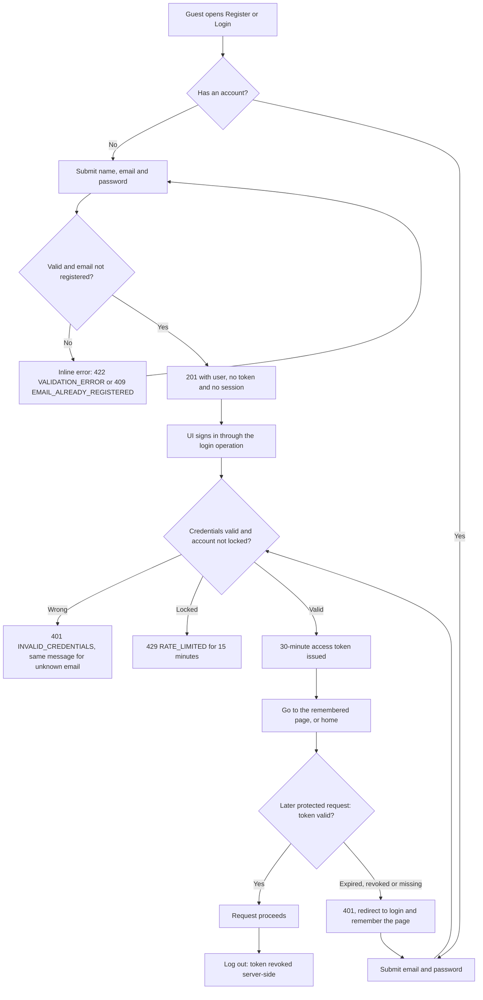

### FL-02 — Browse, search, filter, sort and choose a variant
**Stories:** US-013 – US-025, US-056 · **PRD:** WF-02, FR-016 – FR-030, BR-010 – BR-017, DEC-15

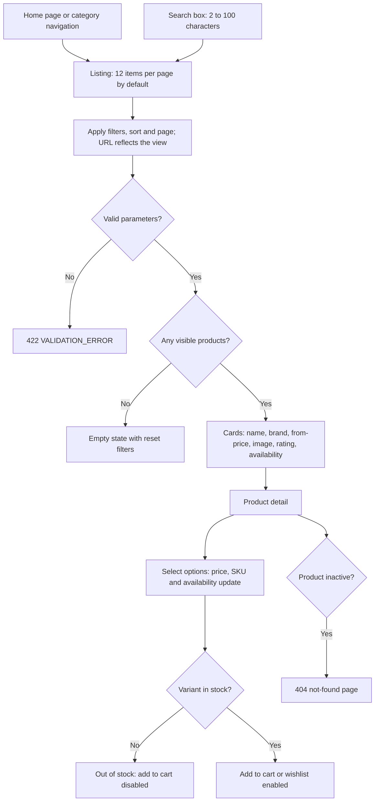

### FL-03 — Order lifecycle
**Stories:** US-052, US-053, US-054, US-073, US-074 · **PRD:** BR-043, BR-045, BR-053, BR-057, FR-071

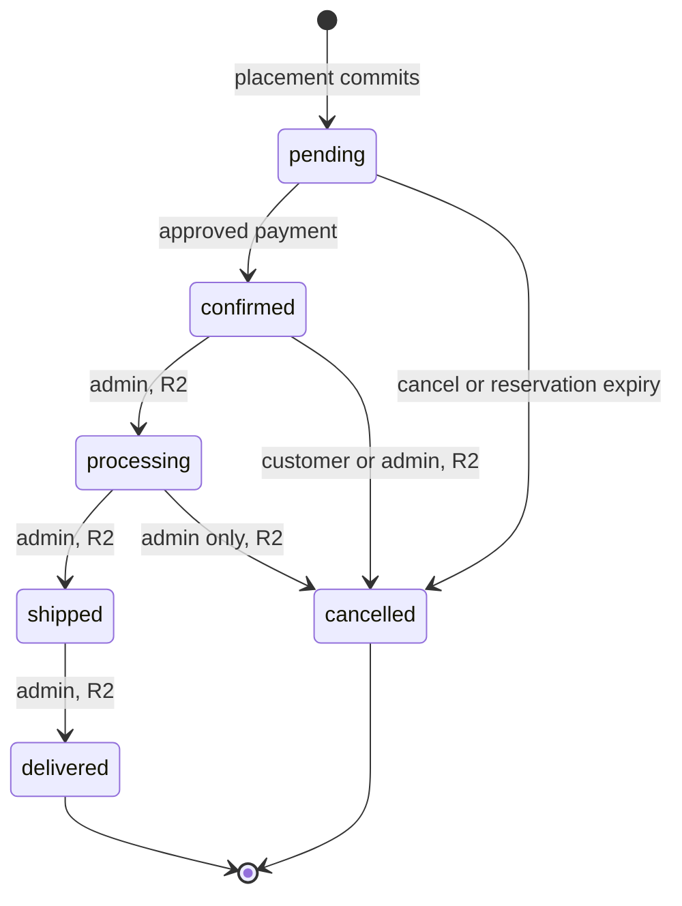

An order is `confirmed` or later only when exactly one approved payment equal to its total exists (BR-045, BR-046). In R1, customers can cancel only `pending` orders; a `confirmed` order is not cancellable until R2 (DEC-26).

### FL-04 — Cart lifecycle and lock
**Stories:** US-026 – US-031, US-043 · **PRD:** FR-111 – FR-113, BR-071, BR-072, DEC-25

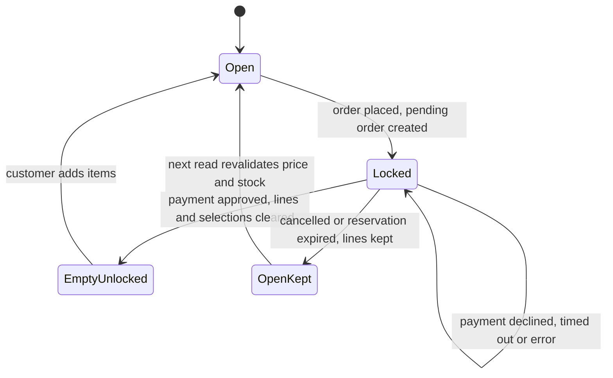

While `Locked`, add, update, remove, clear, coupon, shipping and move-to-cart return 409 `CART_LOCKED`; cart reads still work and show the locked indicator and the pending order id.

### FL-05 — Order placement (PlaceOrder, transaction TX-1)
**Stories:** US-040 – US-043 · **PRD:** WF-06, FR-052 – FR-056, FR-110, FR-115, BR-068, BR-070, BR-071, BR-074

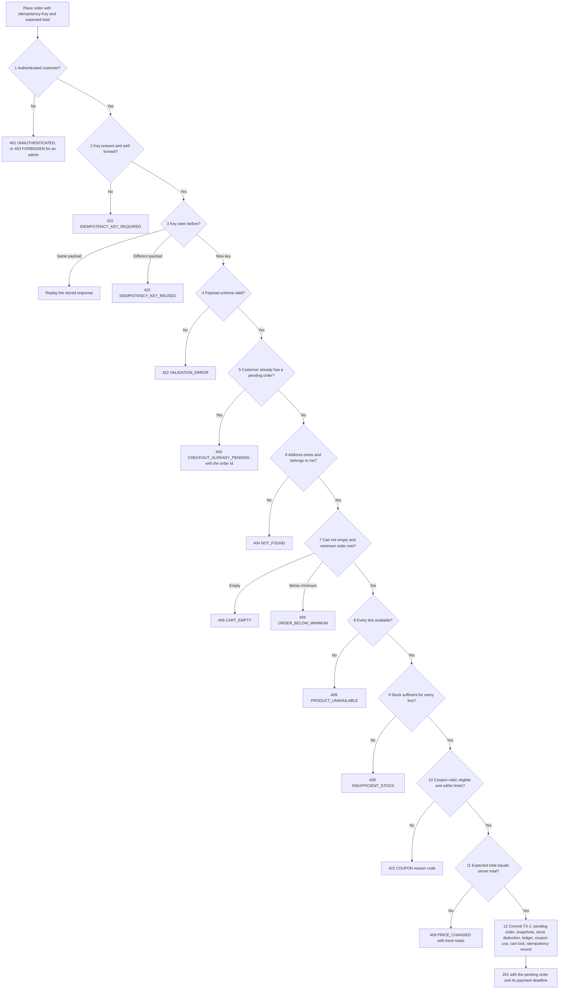

Every failure above creates no order, stock movement, coupon usage or idempotency record. Steps 5 to 11 are evaluated under the customer's cart lock, and the stock check of step 9 is the atomic deduction inside TX-1.

### FL-06 — Payment attempt (PayOrder, transaction TX-2) and simulated outcomes
**Stories:** US-044 – US-047, US-049 · **PRD:** WF-06, WF-07, FR-057 – FR-063, FR-114, BR-044, BR-047, BR-049, BR-069

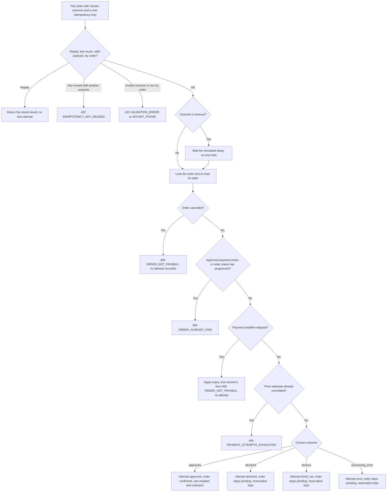

Declined, timed-out and error results are normal 2xx responses whose body carries the attempt status. A technical failure inside PayOrder rolls back only that operation; the order stays `pending` and payable until its deadline.

### FL-07 — Reservation expiry and race resolution
**Stories:** US-048, US-049, US-053 · **PRD:** WF-07, FR-064, FR-114, BR-041, BR-069, BR-073, CL-05, CL-10

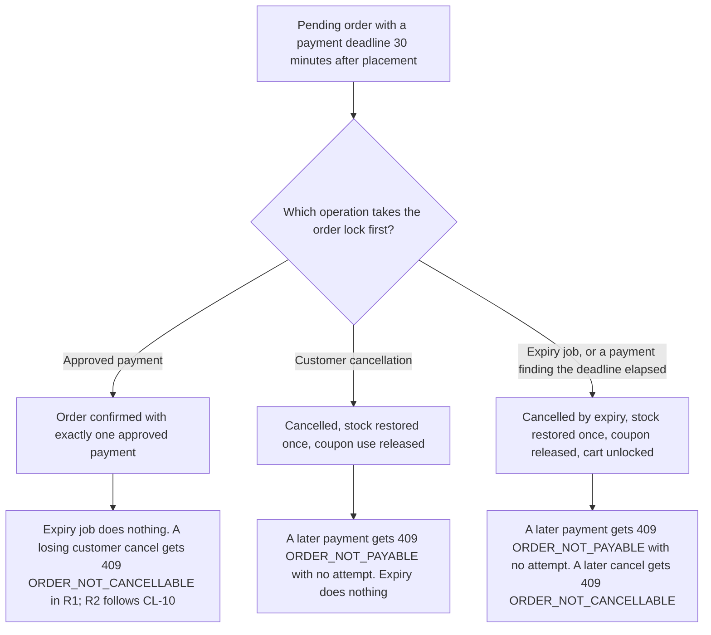

Stock restoration, coupon release, status transitions and refund creation each happen at most once per order. A cancellation or expiry that happens during the simulated `timeout` delay does not wait for the delay.

### FL-08 — Cancellation
**Stories:** US-053, US-054, US-074 · **PRD:** WF-08, FR-072, FR-073, FR-075, FR-094, FR-109, BR-053 – BR-055, DEC-26

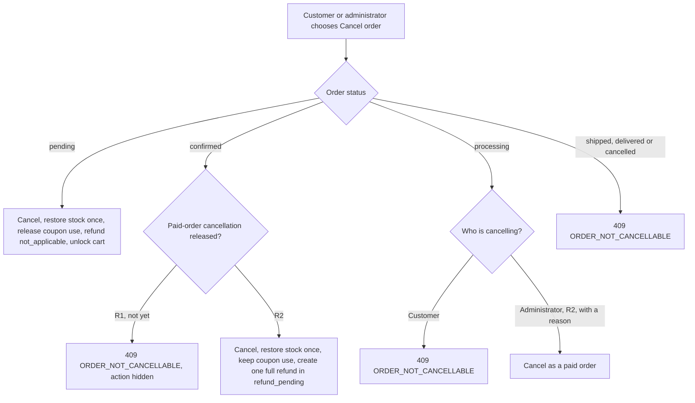

### FL-09 — Refund lifecycle (R2)
**Stories:** US-054, US-055 · **PRD:** FR-074, BR-056, DEC-13

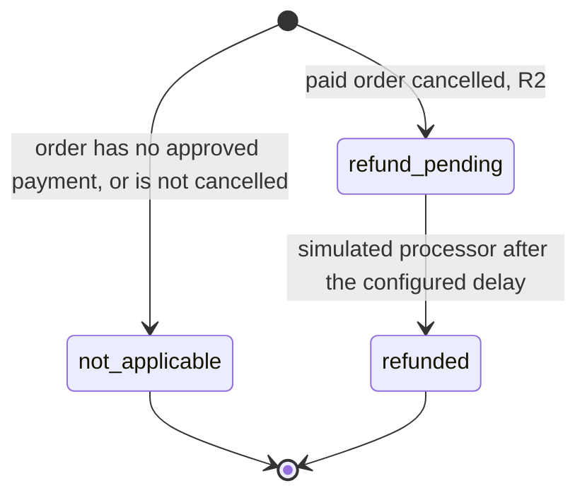

Refunds are full (goods plus shipping), one per order, equal to the amount paid. No real money moves.

### FL-10 — Cart, wishlist and addresses
**Stories:** US-010 – US-012, US-026 – US-034 · **PRD:** WF-03, WF-04, WF-05, FR-011 – FR-015, FR-031 – FR-045, BR-018, BR-021, BR-023

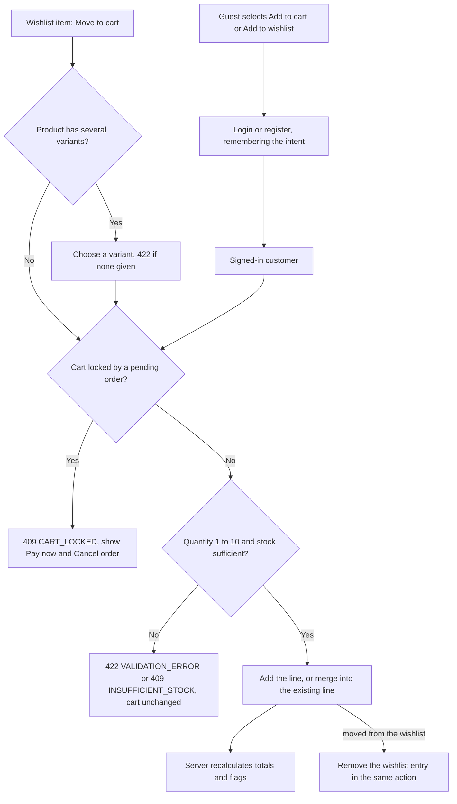

Addresses are managed on their own: the first address becomes the default; at most ten are kept; the default passes to the most recent remaining address when it is deleted; order address snapshots never change (US-010 – US-012).

### FL-11 — Coupon validation
**Stories:** US-035, US-036, US-041 · **PRD:** FR-046 – FR-048, BR-030 – BR-036, BR-075, DEC-28

The PRD does not define which rejection code wins when several conditions fail at once (GAP-11); the order below is illustrative.

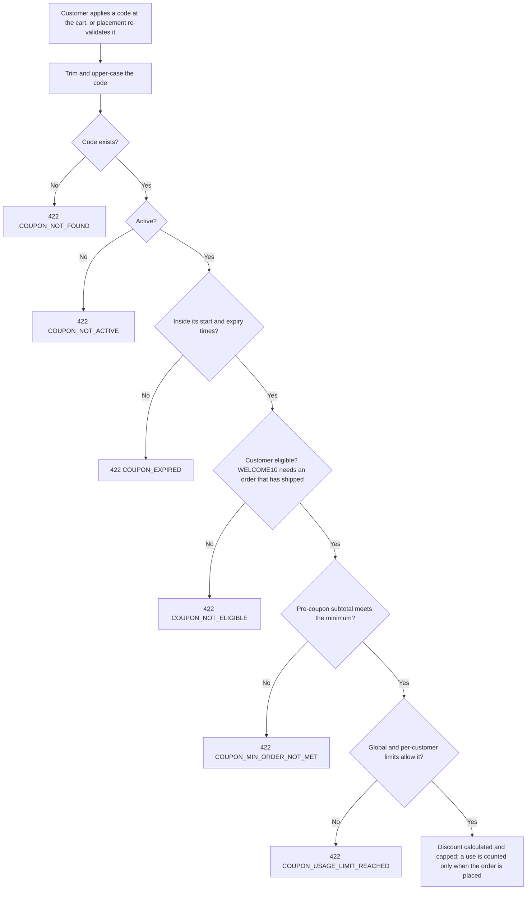

Minimums: `WELCOME10` R500.00 inclusive; `SAVE100` above R800.00 (exclusive). Only one coupon applies per order, and coupons never discount shipping.

### FL-12 — Minimum order and shipping fee
**Stories:** US-037 – US-039 · **PRD:** FR-049, FR-050, FR-116, BR-028, BR-076, BR-077, DEC-29, CL-16

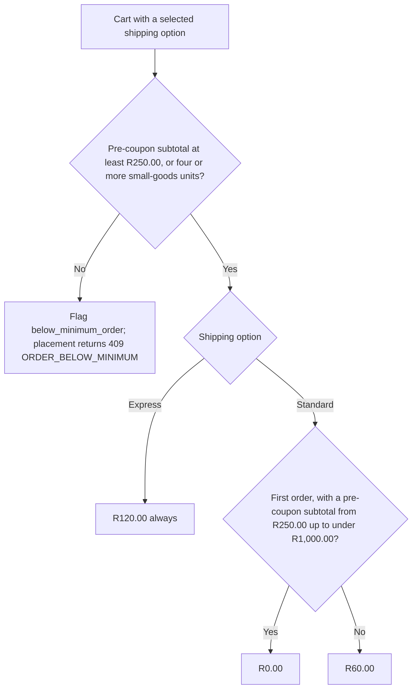

"First order" means no earlier order that is not cancelled, ignoring the order being placed. Small goods are the Wearables and Audio category and its subcategories. The small-goods exception waives only the minimum; it grants no free shipping. A customer using `WELCOME10` is returning by definition and pays R60.00 Standard.

### FL-13 — Order history and detail
**Stories:** US-050, US-051 · **PRD:** WF-08, FR-068 – FR-070, FR-076
1. The customer opens Orders and sees their own orders, newest first, in pages.
2. They open an order and see snapshotted items, delivery address, subtotal, discount, shipping fee, total, order status, payment status, refund status and the chronological status history.
3. **Cancel order** is offered for `pending` orders in R1 and for `confirmed` orders from R2 (DEC-26); other orders offer no cancellation. Where a customer returns to pay a pending order, apart from the cart banner of FR-112, is not specified (GAP-06).
4. Another customer's order, or a non-existent one, returns 404.

### FL-14 — Administration of catalog, inventory and orders (R2)
**Stories:** US-060 – US-074 · **PRD:** WF-10, WF-11, FR-083 – FR-097, BR-057, BR-061 – BR-063
1. The administrator signs in; admin routes and endpoints check the role on every request (guest 401, customer 403).
2. Catalog: create and update products, add variants, manage categories and the small-goods designation, choose images from the managed set; deactivate or reactivate products instead of deleting them.
3. Inventory: adjust a variant by delta or to an absolute value with a mandatory reason; one ledger movement is written per adjustment.
4. Orders: list and filter orders, open an order to see payments, refund, history and ledger movements, advance it one step (`confirmed → processing → shipped → delivered`) or cancel it with a reason.
5. Skipped or reversed transitions and cancellation of `shipped`, `delivered` or `cancelled` orders are rejected with 409.

### FL-15 — Audit events (R2, Should)
**Stories:** US-075, US-076 · **PRD:** WF-12, FR-098 – FR-100, BR-066, DEC-20
1. A designated administrator action succeeds (product, price, variant or category change, inventory adjustment, order status change, admin cancellation, review hiding, admin login).
2. Exactly one append-only audit event is written with actor, role, action, entity, before/after summary, time and request id.
3. The administrator filters the log by actor, action, entity and date. No operation edits or deletes events.

## 6. Validation and exception scenarios

Each scenario states the approved outcome. Status codes and error codes are those of PRD Appendix A; "UI" describes the behaviour a customer or administrator must see, not its styling.

| ID | Scenario | Trigger | Expected behaviour | UI behaviour | Stories | PRD refs |
|---|---|---|---|---|---|---|
| EX-01 | Invalid credentials | Unknown email or wrong password | 401 `INVALID_CREDENTIALS`, identical status, code and message for both | Single generic login error | US-002 | BR-004, AC-005 |
| EX-02 | Account locked | Five consecutive failed logins | 429 `RATE_LIMITED` for 15 minutes, even with the correct password; success resets the counter | "Try again later" message | US-003 | BR-007, AC-008 |
| EX-03 | Missing, expired or revoked token | Protected call without a valid token | 401 `UNAUTHENTICATED` or `TOKEN_EXPIRED` | Redirect to login, remember the page, return after login | US-004, US-005 | FR-005, AC-006, AC-007 |
| EX-04 | Forged token | `alg=none`, wrong signature or edited claims | 401 | As EX-03 | US-002 | SEC-004, AC-011 |
| EX-05 | Customer or guest reaches an admin function | Admin route or endpoint without the role | Guest 401; customer 403 `FORBIDDEN` | Guest to login; customer sees the forbidden page | US-006, US-060 | BR-065, CL-08, AC-061 |
| EX-06 | Administrator uses a shopping function | Admin token on address, cart, wishlist, place-order, pay-order or own-order endpoints | 403 `FORBIDDEN`, no data change | Shopping controls are not offered | US-009, US-031 | BR-065, AC-090 |
| EX-07 | Another customer's record | Cart line, wishlist entry, address or order id owned by someone else | 404 `NOT_FOUND`, no data revealed | Not-found page | US-010, US-031, US-033, US-050 | BR-064, AC-062 |
| EX-08 | Fields the client must not set | `role`, price, discount, shipping fee, total, stock or status in a request | 422 `VALIDATION_ERROR`; nothing changes | Never sent by the UI | US-001, US-028, US-052 | BR-020, SEC-008, AC-010, AC-025 |
| EX-09 | Invalid registration or profile | Weak password, bad email, blank or long name, bad phone | 422 `VALIDATION_ERROR` with field paths; duplicate email 409 `EMAIL_ALREADY_REGISTERED` | Inline field errors | US-001, US-007 | BR-001 – BR-003, AC-002, AC-003 |
| EX-10 | Invalid address | Missing or over-long field, postal code not four digits; eleventh address | 422 with field paths; 409 `ADDRESS_LIMIT_REACHED` | Inline errors; add control explains the limit | US-010 | BR-008, AC-012, AC-091 |
| EX-11 | Invalid list parameters | `page` below 1, `page_size` above 48, search under 2 characters, unknown sort | 422 `VALIDATION_ERROR`; a page beyond the last is 200 with no items | Validation message; empty state for a high page | US-014, US-015, US-017 | BR-014, BR-016, AC-015 |
| EX-12 | Invalid cart quantity | 0, negative, above 10, non-integer, merge above 10, more than 20 lines | 422 `VALIDATION_ERROR` | Inline quantity error | US-026, US-027 | BR-018, AC-023, AC-024, AC-093 |
| EX-13 | Quantity above stock | Add or update above available units | 409 `INSUFFICIENT_STOCK` with available units; cart unchanged | Message with the available quantity | US-026, US-027, US-023 | BR-018, AC-024, AC-019 |
| EX-14 | Stock shortfall at placement | Any line cannot be covered | 409 `INSUFFICIENT_STOCK`; no line is deducted, no order, no coupon use | Cart flags the line; "Place order" disabled | US-041 | BR-038, AC-045 |
| EX-15 | Concurrent purchase of the last units | Many customers order the final units at once | Exactly as many orders succeed as there are units; the others get 409 `INSUFFICIENT_STOCK`; stock never negative | Losers see the stock message | US-041 | BR-037, BR-039, AC-047 |
| EX-16 | Unavailable product in the cart | Product or variant deactivated after being added | Cart read flags `unavailable`; placement 409 `PRODUCT_UNAVAILABLE` listing the line ids | Line marked; checkout blocked until removed | US-029, US-041, US-069 | FR-037, BR-063, AC-076, AC-112 |
| EX-17 | Price changed | Displayed total differs from the server's | 409 `PRICE_CHANGED` with fresh totals; no order | Updated price shown; customer reviews and resubmits | US-029, US-041 | BR-022, AC-027 |
| EX-18 | Coupon not usable | Unknown, inactive or expired code | 422 `COUPON_NOT_FOUND`, `COUPON_NOT_ACTIVE` or `COUPON_EXPIRED` | Reason message; totals unchanged | US-035 | BR-031, BR-032, AC-033 |
| EX-19 | Coupon minimum not met | `WELCOME10` below R500.00; `SAVE100` at or below R800.00 | 422 `COUPON_MIN_ORDER_NOT_MET`; R500.00 is accepted for `WELCOME10`, R800.00 is rejected and R800.01 accepted for `SAVE100` | Reason message | US-035 | BR-033, AC-116 |
| EX-20 | Coupon not for this customer | `WELCOME10` without a shipped or delivered order | 422 `COUPON_NOT_ELIGIBLE` | Reason message | US-035 | BR-075, AC-115 |
| EX-21 | Coupon limits | Per-customer or global limit reached; two customers race for the last global use of `ONCE1` | 422 `COUPON_USAGE_LIMIT_REACHED`; exactly one placement wins; the loser leaves no order, stock or usage change | Reason message | US-035, US-041 | BR-034, BR-035, BR-039, AC-033, AC-034 |
| EX-22 | Coupon invalid at placement | Coupon expired, deactivated, over limit or ineligible between apply and place | 422 with the specific `COUPON_*` code; no order | Cart keeps the coupon selection and shows the reason | US-041 | BR-036, AC-087 |
| EX-23 | Below the minimum order | Pre-coupon subtotal under R250.00 with fewer than four small-goods units | Cart flag `below_minimum_order`; placement 409 `ORDER_BELOW_MINIMUM`; four or more Wearables and Audio units waive the minimum but give no free shipping | Rule explained; "Place order" disabled | US-039 | BR-077, AC-118 |
| EX-24 | Empty cart | Place order with no lines | 409 `CART_EMPTY` | Empty-cart state; no checkout | US-040 | BR-074, AC-037 |
| EX-25 | Missing or foreign address | No `address_id`; address of another customer | 422 `VALIDATION_ERROR` (schema, even while an order is pending); 404 `NOT_FOUND` otherwise | "Place order" disabled until an address is chosen | US-040 | BR-074, AC-077 |
| EX-26 | Missing or malformed idempotency key | No key, or not 8–64 allowed characters | 422 `IDEMPOTENCY_KEY_REQUIRED` | Not user-visible; UI always sends a key | US-042 | BR-070, AC-083 |
| EX-27 | Key reused with a different request | Same key, different payload or outcome | 422 `IDEMPOTENCY_KEY_REUSED` | Not user-visible | US-042, US-047 | BR-070, AC-042, AC-083 |
| EX-28 | Legitimate replay | Same key and payload, even concurrently | Stored response, original status and body; no new order, stock change or attempt; never rejected because the order is pending, paid or cancelled | Same result shown | US-042, US-047 | BR-070, AC-042 |
| EX-29 | Duplicate checkout | New key while a pending order exists | 409 `CHECKOUT_ALREADY_PENDING` with the existing order id (after key, replay and schema checks, before address, cart, stock, coupon and total checks); concurrent attempts create exactly one order | Customer taken to the pending order | US-043 | BR-071, BR-074, AC-078 |
| EX-30 | Cart locked | Any cart change while an order is pending | 409 `CART_LOCKED` with the pending order id; reads allowed | Locked indicator and banner with Pay now and Cancel order | US-043 | BR-071, AC-079 |
| EX-31 | Several preconditions fail at once | Placement violating more than one check | The first failing step of BR-074 is returned; nothing is created or stored | Message for that failure | US-041 | BR-074, AC-114 |
| EX-32 | Invalid payment outcome | A value other than the four outcomes | 422 `VALIDATION_ERROR` | Only the four options are offered | US-044 | FR-057, AC-086 |
| EX-33 | Declined, timed-out or errored payment | Customer chooses such an outcome | 2xx with the attempt status; order stays `pending`; stock, coupon use and cart lock stay; attempt recorded | Payment-failed page with Retry and Cancel | US-046 | BR-047, BR-069, AC-039 – AC-041, AC-082 |
| EX-34 | Attempts exhausted | Fourth attempt | 409 `PAYMENT_ATTEMPTS_EXHAUSTED`; five concurrent attempts commit exactly three | Only Cancel offered | US-046 | BR-049, AC-044, AC-113 |
| EX-35 | Paying a paid order | Payment on a confirmed or later order | 409 `ORDER_ALREADY_PAID`; one approved payment only | Order shown as paid | US-047 | BR-046, AC-043 |
| EX-36 | Paying a cancelled or expired order | Payment after cancellation, or after the deadline | 409 `ORDER_NOT_PAYABLE`; no attempt; if the deadline had elapsed, expiry is applied first | Order shown as cancelled or expired | US-049 | BR-069, AC-084 |
| EX-37 | Payment races cancellation or expiry | Operations at the same moment, including during the simulated timeout delay | One winner under the order lock; the loser has no side effects; stock restored and coupon released at most once | Final state shown after refresh | US-049 | BR-073, AC-084, AC-105, AC-106, AC-107 |
| EX-38 | Technical failure in payment | Error before the attempt commits | Only the payment operation rolls back; order stays `pending` and payable; attempt count unchanged | Generic failure message; the customer may retry | US-046 | BR-069, AC-082, AC-113 |
| EX-39 | Reservation expiry | Deadline passes without an approved payment | Order cancelled, stock restored once, coupon released, cart unlocked with lines kept, within 60 s | Order shown as cancelled | US-048 | BR-041, CL-05, AC-046, AC-081 |
| EX-40 | Order cannot be cancelled | Cancel on `cancelled`, `shipped` or `delivered`; in R1 also `confirmed`; customer on `processing` | 409 `ORDER_NOT_CANCELLABLE`; no effects | Cancel action hidden or disabled | US-053, US-054 | BR-053, DEC-26, AC-053, AC-075 |
| EX-41 | Concurrent cancellations | Two cancellations, or cancel racing expiry | One succeeds; stock restored once; at most one refund (R2) | Final state shown | US-053, US-054 | FR-075, FR-109, AC-054, AC-074 |
| EX-42 | Invalid status transition | Skip, reverse, administrator `pending → confirmed`, or leaving `cancelled` | 409 `INVALID_STATUS_TRANSITION` | Only allowed next steps offered | US-052, US-073 | BR-043, BR-057, AC-056, AC-085 |
| EX-43 | Wishlist conflicts | Duplicate add; move-to-cart without variant, out of stock, or locked cart | 409 `WISHLIST_DUPLICATE`; 422; 409 `INSUFFICIENT_STOCK`; 409 `CART_LOCKED`; the entry stays on any failure | Toggle control; clear messages | US-032, US-034 | BR-023, AC-030, AC-031 |
| EX-44 | Review not allowed (R2) | No delivered order; rating outside 1–5; comment over 1,000 characters; second review | 403 `REVIEW_NOT_ELIGIBLE`; 422; 409 `REVIEW_DUPLICATE` | Inline errors | US-058 | BR-058, BR-059, AC-058, AC-059 |
| EX-45 | Administrative conflicts (R2) | Deactivating a category that has active products; duplicate SKU, slug or option set; inventory below zero or without a reason | 409 `CATEGORY_NOT_EMPTY`; duplicate rejected (code per CL-02); 422 `VALIDATION_ERROR` (CL-11); nothing changes | Inline errors | US-061, US-065, US-066, US-067 | BR-061, BR-062, CL-02, CL-11, AC-064, AC-065 |
| EX-46 | Platform guards | Database unreachable; test tools called outside `local`/`test` | Readiness 503 `NOT_READY`; test tools 404 | None for shoppers | US-079, US-081 | FR-103, SEC-018, AC-067, AC-069 |

## 7. UI states and interaction behaviour

These rows specify **what must be true on screen** for each state. Layout, wording, colour, spacing and wireframes belong to `DESIGN_BRIEF_AND_WIREFRAMES.md`.

| ID | State | Where it applies | Required behaviour | Stories | PRD refs |
|---|---|---|---|---|---|
| UI-01 | Loading | Listings, product detail, cart, checkout, order pages, payment in progress | An explicit, detectable loading indication; controls that would repeat an in-flight action are disabled to prevent double submission | US-014, US-041, US-044, US-086 | TR-012, FR-056 |
| UI-02 | Success feedback | Add to cart, wishlist change, address saved, profile saved, order placed or confirmed, cancellation done | A visible confirmation of the result; the cart count and totals update | US-026, US-032, US-045 | FR-040, FR-065 |
| UI-03 | Field validation error | Registration, login, profile, password, address, quantity, coupon, admin forms | Server errors appear next to the offending field using the field path in the error; focus moves to the first error and the error is announced; input already typed is kept | US-001, US-010, US-026 | FR-013, FR-108, NFR-011 |
| UI-04 | Request failed | Any failed call that is not a field error | A clear, non-technical message; no stack trace or SQL; the request id is available to support the investigation (presentation per GAP-09) | US-084 | FR-108, NFR-016, SEC-015 |
| UI-05 | Empty list or result | Search and filters, category, wishlist, order history | An empty state explaining there is nothing to show; for search and filters, a control that resets them; a page beyond the last also shows it | US-013, US-018, US-033, US-050 | FR-026, FR-021 |
| UI-06 | Unavailable product | Listings, product page, wishlist, cart | Out-of-stock and inactive-product states are distinct: out of stock stays listed with a disabled add-to-cart; an inactive product is absent from public views and shows not-found on direct access; in the cart and wishlist an unavailable item is flagged | US-023, US-024, US-029, US-033 | FR-024, FR-025, FR-037, FR-043 |
| UI-07 | Low stock | Listings and product page | A low-stock indication when 1–5 units remain | US-023 | FR-024, BR-012 |
| UI-08 | Price changed | Cart | The old and new prices are shown and checkout remains possible; submitting with the stale total is refused with fresh totals | US-029, US-041 | FR-037, BR-022 |
| UI-09 | Empty cart | Cart and checkout entry | An empty-cart state with a path back to shopping; no checkout action | US-028, US-040 | FR-036, FR-052 |
| UI-10 | Locked cart | Cart, header, checkout entry | A locked indicator, a pending-order banner with **Pay now** and **Cancel order**, and all cart-changing controls disabled; wishlist remains usable | US-043 | FR-112, BR-071 |
| UI-11 | Below minimum order | Cart and checkout | The rule is stated (R250.00, or four or more Wearables and Audio units); "Place order" is disabled; the reason is available to assistive technology | US-039 | FR-116, BR-077 |
| UI-12 | Coupon result | Cart and checkout | An applied coupon shows its discount and can be removed; a rejected code shows the specific reason from the error code; totals never change on rejection | US-035, US-036 | FR-046, FR-047 |
| UI-13 | Shipping fee | Cart and checkout | Each option shows the fee that applies to this cart and its static estimate; a free first-order Standard fee is shown as R0.00; the fee shown equals the fee stored on the order | US-037, US-038 | FR-049, FR-050, BR-076 |
| UI-14 | Checkout blocked | Checkout review | "Place order" is disabled with an explanation when there is no address, a blocking line, or the minimum is not met; a customer with no saved address can add one inline | US-040 | FR-052, FR-053 |
| UI-15 | Simulated payment control | Checkout payment step | A clearly labelled "Simulated payment" control with exactly four options (approved, declined, timeout, processing error); no card, CVV or expiry fields exist | US-044 | FR-057, FR-066 |
| UI-16 | Payment in progress | After submitting a payment, especially `timeout` | A visible waiting state for the simulated delay; the submit control is disabled; the customer is not shown an outcome until the response arrives | US-044, US-046 | FR-060, TR-012 |
| UI-17 | Payment approved | After an approved payment | Confirmation page with order number, items, address snapshot, totals and statuses; the cart is shown empty and unlocked | US-045 | FR-058, FR-065 |
| UI-18 | Payment not approved | After declined, timeout or error | Payment-failed page stating the outcome, with **Retry** and **Cancel order**; the order is shown as still reserved and the cart as locked | US-046 | FR-059 – FR-061, FR-065 |
| UI-19 | Attempts exhausted | After the third non-approved attempt | Retry is no longer offered; only **Cancel order** remains | US-046 | FR-062, BR-049 |
| UI-20 | Order cancelled or expired | Order detail, payment page | The order shows `cancelled`; a payment attempt on it is refused and the customer is told it is no longer payable; the cart is shown unlocked with its lines | US-048, US-049, US-053 | FR-064, FR-114 |
| UI-21 | Cancel confirmation | Cancel order (and, per GAP-08, other destructive actions) | A confirmation step before the cancellation is sent; afterwards the resulting order and refund status are shown | US-053, US-054 | WF-08 |
| UI-22 | Session ended | Any protected page | The customer is redirected to login with the intended page remembered and returns to it after login | US-005, US-006 | FR-005, FR-006 |
| UI-23 | Forbidden and not found | Admin routes for customers; inactive or unknown products; other customers' records | A forbidden page for role violations (CL-08); a not-found page for missing or non-owned records | US-006, US-024, US-060 | CL-08, BR-064, FR-025 |
| UI-24 | Responsive navigation | All pages, 360–1920 px | Search, categories, cart, wishlist and account stay reachable at every supported width, using a collapsible navigation on narrow screens that is operable by touch and keyboard and exposes its expanded state to assistive technology; the page never scrolls sideways | US-085 | NFR-013, NFR-011 |
| UI-25 | Keyboard and assistive technology | All flows | Every action is reachable by keyboard in a logical order; focus is visible and managed after dialogs and errors; controls have accessible names and labels; images have alt text; status changes (cart updates, payment results, errors) are announced | US-085, US-086 | NFR-011, NFR-012, FR-029, TR-002 |
| UI-26 | Demo-store notice | All pages and football-shirt products | The site-wide demo notice and the per-product fictional/unofficial notice are visible | US-025 | FR-028, BR-017 |
| UI-27 | Administrator results | Admin screens (R2) | Create, update, deactivate, adjust, advance and cancel actions show their result or the specific validation error; rejected inventory adjustments leave the displayed stock unchanged | US-061 – US-074 | FR-083 – FR-095 |

## 8. Traceability matrix

Generated from the story references and checked against the PRD requirement table. A requirement is **mapped** when at least one story lists it in its PRD refs; "Primary story" is a story whose release equals the requirement's release.

### 8.1 Must-level functional requirements

| FR | Rel | Stories | Primary story |
|---|---|---|---|
| FR-001 | R1 | US-001 | US-001 |
| FR-002 | R1 | US-001 | US-001 |
| FR-003 | R1 | US-002 | US-002 |
| FR-004 | R1 | US-004 | US-004 |
| FR-005 | R1 | US-005 | US-005 |
| FR-006 | R1 | US-006 | US-006 |
| FR-007 | R1 | US-007 | US-007 |
| FR-008 | R1 | US-008 | US-008 |
| FR-010 | R1 | US-009 | US-009 |
| FR-011 | R1 | US-010 | US-010 |
| FR-012 | R1 | US-011 | US-011 |
| FR-013 | R1 | US-010 | US-010 |
| FR-014 | R1 | US-010 | US-010 |
| FR-015 | R1 | US-012 | US-012 |
| FR-016 | R1 | US-013 | US-013 |
| FR-017 | R1 | US-014, US-056 | US-014 |
| FR-018 | R1 | US-015 | US-015 |
| FR-019 | R1 | US-016 | US-016 |
| FR-020 | R1 | US-017, US-056 | US-017 |
| FR-021 | R1 | US-014 | US-014 |
| FR-022 | R1 | US-021, US-056 | US-021 |
| FR-023 | R1 | US-022 | US-022 |
| FR-024 | R1 | US-023 | US-023 |
| FR-025 | R1 | US-024 | US-024 |
| FR-026 | R1 | US-018 | US-018 |
| FR-028 | R1 | US-025 | US-025 |
| FR-029 | R1 | US-021 | US-021 |
| FR-031 | R1 | US-005, US-031 | US-005 |
| FR-032 | R1 | US-026 | US-026 |
| FR-033 | R1 | US-027 | US-027 |
| FR-034 | R1 | US-027 | US-027 |
| FR-035 | R1 | US-026 | US-026 |
| FR-036 | R1 | US-028 | US-028 |
| FR-037 | R1 | US-029, US-039, US-069 | US-029 |
| FR-038 | R1 | US-030 | US-030 |
| FR-039 | R1 | US-028 | US-028 |
| FR-041 | R1 | US-032 | US-032 |
| FR-042 | R1 | US-032 | US-032 |
| FR-043 | R1 | US-033 | US-033 |
| FR-044 | R1 | US-034 | US-034 |
| FR-045 | R1 | US-033 | US-033 |
| FR-046 | R1 | US-035 | US-035 |
| FR-047 | R1 | US-036 | US-036 |
| FR-048 | R1 | US-035 | US-035 |
| FR-049 | R1 | US-037, US-038 | US-037 |
| FR-050 | R1 | US-037, US-038 | US-037 |
| FR-051 | R1 | US-035 | US-035 |
| FR-052 | R1 | US-040 | US-040 |
| FR-053 | R1 | US-040 | US-040 |
| FR-054 | R1 | US-041 | US-041 |
| FR-055 | R1 | US-041 | US-041 |
| FR-056 | R1 | US-042 | US-042 |
| FR-057 | R1 | US-044 | US-044 |
| FR-058 | R1 | US-045 | US-045 |
| FR-059 | R1 | US-046 | US-046 |
| FR-060 | R1 | US-046 | US-046 |
| FR-061 | R1 | US-046 | US-046 |
| FR-062 | R1 | US-046 | US-046 |
| FR-063 | R1 | US-047 | US-047 |
| FR-064 | R1 | US-048, US-049 | US-048 |
| FR-065 | R1 | US-045, US-046 | US-045 |
| FR-066 | R1 | US-044 | US-044 |
| FR-067 | R1 | US-045, US-046, US-072 | US-045 |
| FR-068 | R1 | US-050 | US-050 |
| FR-069 | R1 | US-051 | US-051 |
| FR-070 | R1 | US-051 | US-051 |
| FR-071 | R1 | US-052 | US-052 |
| FR-072 | R1 | US-053 | US-053 |
| FR-073 | R2 | US-054 | US-054 |
| FR-074 | R2 | US-055 | US-055 |
| FR-075 | R1 | US-049, US-053 | US-049 |
| FR-076 | R1 | US-051, US-052 | US-051 |
| FR-077 | R2 | US-058 | US-058 |
| FR-078 | R2 | US-058 | US-058 |
| FR-079 | R2 | US-058 | US-058 |
| FR-080 | R2 | US-058 | US-058 |
| FR-081 | R2 | US-057 | US-057 |
| FR-083 | R2 | US-006, US-060 | US-060 |
| FR-084 | R2 | US-061 | US-061 |
| FR-085 | R2 | US-062 | US-062 |
| FR-086 | R2 | US-063 | US-063 |
| FR-087 | R2 | US-064 | US-064 |
| FR-088 | R2 | US-065 | US-065 |
| FR-089 | R2 | US-066 | US-066 |
| FR-090 | R2 | US-067 | US-067 |
| FR-091 | R2 | US-071 | US-071 |
| FR-092 | R2 | US-072 | US-072 |
| FR-093 | R2 | US-073 | US-073 |
| FR-094 | R2 | US-074 | US-074 |
| FR-095 | R2 | US-070 | US-070 |
| FR-096 | R2 | US-063, US-069 | US-063 |
| FR-103 | R1 | US-079 | US-079 |
| FR-104 | R1 | US-080 | US-080 |
| FR-105 | R1 | US-081 | US-081 |
| FR-106 | R1 | US-082 | US-082 |
| FR-107 | R1 | US-083 | US-083 |
| FR-108 | R1 | US-084 | US-084 |
| FR-109 | R2 | US-054 | US-054 |
| FR-110 | R1 | US-041, US-044 | US-041 |
| FR-111 | R1 | US-043 | US-043 |
| FR-112 | R1 | US-005, US-043 | US-005 |
| FR-113 | R1 | US-043 | US-043 |
| FR-114 | R1 | US-049 | US-049 |
| FR-115 | R1 | US-040, US-041 | US-040 |
| FR-116 | R1 | US-039 | US-039 |

### 8.2 Should and Could functional requirements

| FR | Pri | Rel | Stories |
|---|---|---|---|
| FR-009 | S | R1 | US-003 |
| FR-027 | S | R1 | US-019 |
| FR-030 | S | R1 | US-020 |
| FR-040 | S | R1 | US-028 |
| FR-082 | C | R2 | US-059 |
| FR-097 | S | R2 | US-068 |
| FR-098 | S | R2 | US-075 |
| FR-099 | S | R2 | US-076 |
| FR-100 | S | R2 | US-075 |
| FR-101 | C | R3 | US-077 |
| FR-102 | C | R3 | US-078 |

### 8.3 Coverage summary

- Functional requirements in the PRD: 116 (105 Must, 8 Should, 3 Could).
- Must-level requirements mapped to at least one story: **105 of 105**; unmapped: 0.
- Should/Could requirements mapped: 11 of 11.
- User stories: 86; stories with no functional requirement of their own are the platform and quality stories US-085 and US-086, which trace to NFR and TR identifiers.
- **Requirement gaps:** none. Every functional requirement has a story. Open points found while writing the stories are listed as observations in §10; none of them creates a requirement.

## 9. Release scope and dependencies

### 9.1 Scope by release

| Release | Scope | Stories | M / S / C |
|---|---|---|---|
| R1 | MVP: accounts, addresses, discovery, product detail, cart, wishlist, coupons, shipping, minimum order, checkout, simulated payment, order history and detail, cancellation of unpaid orders, reservation expiry, read-only seeded ratings, platform and quality (PRD §4.3, DEC-01) | 62 (US-001 – US-086 in part) | 59 / 3 / 0 |
| R2 | Paid-order cancellation and simulated refunds, reviews, administration of catalog, inventory and orders, audit events | 22 (US-054 – US-076 in part) | 18 / 3 / 1 |
| R3 | Optional in-app notifications, only after separate approval | 2 (US-077 – US-078 in part) | 0 / 0 / 2 |

Stories whose release reads "R1 (… R2)" are counted under R1; their R2 part is named in the story and is verified only when the R2 requirement is delivered: US-006 (admin routes), US-051 (refund fields), US-052 (administrator transitions), US-085 (admin screens), and US-056 (ratings are read-only seeded data, CL-01).

### 9.2 Dependencies

| Story | Depends on | Reason |
|---|---|---|
| US-002 | US-001 or a seeded account (TR-003) | Login needs an existing account; seeded customer and administrator accounts also support independent tests |
| US-003 – US-008 | US-002 | Lockout, logout, session recovery, protected routes, profile and password flows use the authentication capability |
| US-009 | Seed/CLI provisioning (FR-010, TR-003); US-002 for sign-in verification | Administrator accounts are provisioned outside the public UI and then use the normal login flow; this story does not depend on itself |
| US-026 – US-034 | US-002, US-021 – US-023 | Cart and wishlist need a signed-in customer and a variant to choose |
| US-035 – US-039 | US-028, US-080 | Totals and shipping need the cart and deterministic seeded data; R1 `WELCOME10` tests use a seeded returning customer because admin shipping transitions arrive in R2 |
| US-040, US-041 | US-010, US-028, US-035 – US-039 | Placement needs an address, a valid cart and the totals rules |
| US-042, US-043 | US-041 | Idempotency and the cart lock are properties of placement |
| US-044 – US-047 | US-041 | Payment operations act on a pending order |
| US-048, US-053 | US-041 | Expiry and unpaid cancellation act on a placed pending order; they do not require a previous failed-payment attempt |
| US-049 | US-041, US-044 – US-048, US-053 | Race resolution combines payment, expiry and cancellation paths |
| US-050, US-051 | US-041; US-045 provides a confirmed-order scenario | Orders must exist to list or inspect; payment approval is a useful test state, not a prerequisite for viewing a pending order |
| US-054 (R2) | US-045, US-053 | Paid cancellation needs a confirmed order and reuses the cancellation/stock-restoration path; refund completion is a downstream outcome |
| US-055 (R2) | US-054 | The refund processor completes a refund created by paid-order cancellation |
| US-056 (R1), US-057 (R2) | US-014, US-021, US-080 | Ratings in R1 and review lists in R2 use deterministic seeded review data and product/listing pages |
| US-060 (R2) | US-002, US-009 | The admin area requires an authenticated, provisioned administrator |
| US-061 – US-074 (R2) | US-060 | Catalog, inventory and order administration require the role-protected admin area |
| US-066 (R2) | US-039, US-080 | The small-goods designation is seeded in R1 and becomes editable in R2 |
| US-069 (R2) | US-029 | Carts already flag price and availability changes in R1 |
| US-073 (R2) | US-045 | Administrators advance only confirmed orders |
| US-074 (R2) | US-053, US-054 | Administrator cancellation reuses the cancellation effects |
| US-075, US-076 (R2) | US-061 – US-074 | Audit events record those actions |
| US-077, US-078 (R3) | US-045, US-046, US-053, US-055, US-073 | Notifications follow order, payment and refund events |
| US-085, US-086 | All UI stories | Responsiveness, accessibility and selectors apply to every screen |

## 10. Observations about the PRD

While writing the stories, these points were found where the PRD is silent or leaves room for interpretation. **None is a new requirement and none changes an approved rule.** Each is a question for the design brief, technical architecture or the owner; until answered, the stories assume nothing beyond the PRD.

| ID | Observation | Stories | Suggested home |
|---|---|---|---|
| GAP-01 | The PRD invalidates all earlier tokens after a password change but does not say whether the response signs the customer in again or the customer must log in. The story assumes the customer logs in again | US-008 | Technical architecture |
| GAP-02 | The response when adding to the cart or wishlist an inactive, removed or unknown product or variant is not specified (FR-025 covers direct page access only) | US-026, US-032 | Technical architecture |
| GAP-03 | Whether guests see a cart or wishlist indicator, and whether the wishlist has a count like the cart (FR-040) | US-028 | Design brief |
| GAP-04 | Which fields each entry of the order-history list shows | US-050 | Design brief |
| GAP-05 | The reviewer name shown with a review and the ordering and paging of reviews | US-057 | Design brief |
| GAP-06 | Whether the customer sees the payment deadline, and how they return to a pending order other than through the cart banner (FR-112) | US-043, US-048 | Design brief |
| GAP-07 | Search, filter and paging of the administrator product list | US-064 | Design brief |
| GAP-08 | Which actions besides order cancellation (WF-08) need a confirmation step, for example deleting an address or clearing the cart | US-010, US-027 | Design brief |
| GAP-09 | Wording, tone and localisation of messages, and whether the request id is shown to users (English only, ASM-01) | All UI stories | Design brief |
| GAP-10 | Whether a customer gives a reason when cancelling (administrators must, FR-094; BR-052 says "reason where required") | US-053, US-054 | Owner / design brief |
| GAP-11 | The PRD does not say which `COUPON_*` code wins when several conditions fail at once | US-035 | Technical architecture |

## Appendix A — Story index

| Story | Title | Epic | Actor | Pri | Release |
|---|---|---|---|---|---|
| US-001 | Register a customer account | EP-01 | Guest | M | R1 |
| US-002 | Log in | EP-01 | Guest (customer or administrator account) | M | R1 |
| US-003 | Throttle repeated failed logins | EP-01 | Guest | S | R1 |
| US-004 | Log out | EP-01 | Customer / Administrator | M | R1 |
| US-005 | Resume after session expiry | EP-01 | Customer | M | R1 |
| US-006 | Protected pages require login | EP-01 | Guest | M | R1 (admin routes R2) |
| US-007 | View and update my profile | EP-01 | Customer | M | R1 |
| US-008 | Change my password | EP-01 | Customer | M | R1 |
| US-009 | Provision administrator accounts safely | EP-01 | Operator | M | R1 |
| US-010 | Manage saved delivery addresses | EP-02 | Customer | M | R1 |
| US-011 | Default delivery address | EP-02 | Customer | M | R1 |
| US-012 | Past orders keep their delivery address | EP-02 | Customer | M | R1 |
| US-013 | Browse categories | EP-03 | Guest / Customer | M | R1 |
| US-014 | Product listing and pagination | EP-03 | Guest / Customer | M | R1 |
| US-015 | Search by product name or brand | EP-03 | Guest / Customer | M | R1 |
| US-016 | Filter products | EP-03 | Guest / Customer | M | R1 |
| US-017 | Sort products | EP-03 | Guest / Customer | M | R1 |
| US-018 | Empty results | EP-03 | Guest / Customer | M | R1 |
| US-019 | Shareable listing URLs | EP-03 | Guest / Customer | S | R1 |
| US-020 | Home page entry points | EP-03 | Guest / Customer | S | R1 |
| US-021 | View product details | EP-04 | Guest / Customer | M | R1 |
| US-022 | Choose product variants | EP-04 | Guest / Customer | M | R1 |
| US-023 | Availability and out-of-stock handling | EP-04 | Guest / Customer | M | R1 |
| US-024 | Inactive products are not found | EP-04 | Guest / Customer | M | R1 |
| US-025 | Demo-store and fictional-listing notices | EP-04 | Guest / Customer | M | R1 |
| US-026 | Add a product variant to my cart | EP-05 | Customer | M | R1 |
| US-027 | Change quantities, remove lines or clear the cart | EP-05 | Customer | M | R1 |
| US-028 | See my cart summary with server-calculated totals | EP-05 | Customer | M | R1 |
| US-029 | See what has changed or cannot be bought | EP-05 | Customer | M | R1 |
| US-030 | Guests are sent to login and their action completes | EP-05 | Guest | M | R1 |
| US-031 | My cart persists and is mine alone | EP-05 | Customer | M | R1 |
| US-032 | Add and remove wishlist items | EP-06 | Customer | M | R1 |
| US-033 | View my wishlist | EP-06 | Customer | M | R1 |
| US-034 | Move a wishlist item to my cart | EP-06 | Customer | M | R1 |
| US-035 | Apply a coupon code | EP-07 | Customer | M | R1 |
| US-036 | Remove an applied coupon | EP-07 | Customer | M | R1 |
| US-037 | Choose a shipping option and see its fee | EP-07 | Customer | M | R1 |
| US-038 | Free Standard shipping on a qualifying first order | EP-07 | Customer | M | R1 |
| US-039 | Minimum order and the small-goods exception | EP-07 | Customer | M | R1 |
| US-040 | Review my order before paying | EP-08 | Customer | M | R1 |
| US-041 | Place the order and reserve stock | EP-08 | Customer | M | R1 |
| US-042 | Retries never create a second order | EP-08 | Customer | M | R1 |
| US-043 | One pending order and a locked cart | EP-08 | Customer | M | R1 |
| US-044 | Choose a simulated payment outcome | EP-08 | Customer | M | R1 |
| US-045 | Approved payment confirms my order | EP-08 | Customer (with the payment simulator) | M | R1 |
| US-046 | Failed payments and retries | EP-08 | Customer (with the payment simulator) | M | R1 |
| US-047 | Duplicate payment requests are safe | EP-08 | Customer | M | R1 |
| US-048 | Unpaid orders expire and release their stock | EP-08 | Reservation-expiry job | M | R1 |
| US-049 | Payment, cancellation and expiry never conflict | EP-08 | Customer / Reservation-expiry job | M | R1 |
| US-050 | See my order history | EP-09 | Customer | M | R1 |
| US-051 | See the full detail of an order | EP-09 | Customer | M | R1 (refund fields populated from R2) |
| US-052 | Order status always follows the allowed transitions | EP-09 | System | M | R1 (administrator transitions R2) |
| US-053 | Cancel an unpaid pending order | EP-09 | Customer | M | R1 |
| US-054 | Cancel a paid order (R2) | EP-09 | Customer | M | R2 |
| US-055 | Simulated refund completes (R2) | EP-09 | Refund processor | M | R2 |
| US-056 | See ratings in listings and on product pages | EP-10 | Guest / Customer | M | R1 (read-only seeded data) |
| US-057 | Read reviews on a product (R2) | EP-10 | Guest / Customer | M | R2 |
| US-058 | Rate and review a product I received (R2) | EP-10 | Customer | M | R2 |
| US-059 | Hide a review (R2, optional) | EP-10 | Administrator | C | R2 |
| US-060 | Administrators only | EP-11 | Administrator | M | R2 |
| US-061 | Create a product | EP-11 | Administrator | M | R2 |
| US-062 | Update a product | EP-11 | Administrator | M | R2 |
| US-063 | Deactivate and reactivate a product | EP-11 | Administrator | M | R2 |
| US-064 | Inspect any product | EP-11 | Administrator | M | R2 |
| US-065 | Manage variants | EP-11 | Administrator | M | R2 |
| US-066 | Manage categories and the small-goods designation | EP-11 | Administrator | M | R2 |
| US-067 | Adjust inventory with a reason | EP-11 | Administrator | M | R2 |
| US-068 | Choose product images from the managed set | EP-11 | Administrator | S | R2 |
| US-069 | Catalog changes affect carts but never orders | EP-11 | Administrator | M | R2 |
| US-070 | Administrator input follows the same rules | EP-11 | Administrator | M | R2 |
| US-071 | List and filter orders | EP-12 | Administrator | M | R2 |
| US-072 | Inspect an order, its payments and its stock movements | EP-12 | Administrator | M | R2 |
| US-073 | Move an order forward | EP-12 | Administrator | M | R2 |
| US-074 | Cancel an order on a customer's behalf | EP-12 | Administrator | M | R2 |
| US-075 | Sensitive administrator actions are recorded | EP-13 | System | S | R2 |
| US-076 | Review the audit log | EP-13 | Administrator | S | R2 |
| US-077 | Customers receive in-app notifications (R3, optional) | EP-13 | System | C | R3 |
| US-078 | Read and clear my notifications (R3, optional) | EP-13 | Customer | C | R3 |
| US-079 | Know when the system is alive and ready | EP-14 | Operator / SDET engineer | M | R1 |
| US-080 | Reset to a known baseline | EP-14 | Operator / SDET engineer | M | R1 |
| US-081 | Guarded test-support tools | EP-14 | Operator / SDET engineer | M | R1 |
| US-082 | A trustworthy API description | EP-14 | Operator / SDET engineer | M | R1 |
| US-083 | Business parameters are configuration | EP-14 | Operator / SDET engineer | M | R1 |
| US-084 | One consistent error format | EP-14 | Customer / Administrator / Operator | M | R1 |
| US-085 | Core flows work on any screen and with a keyboard | EP-14 | Guest / Customer | M | R1 (admin screens R2) |
| US-086 | Testable and diagnosable screens | EP-14 | Operator / SDET engineer | M | R1 |

## Appendix B — Change log

| Version | Date | Change |
|---|---|---|
| 0.1 | 2026-10-13 | First draft for owner review, based on PRD v0.6. No other planning document was created and no application code was written |
